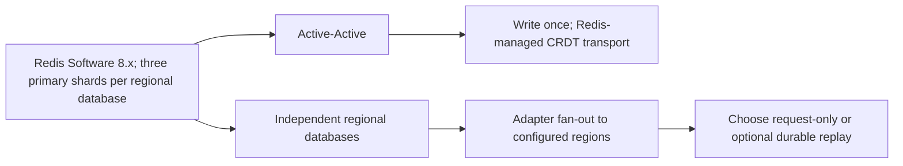
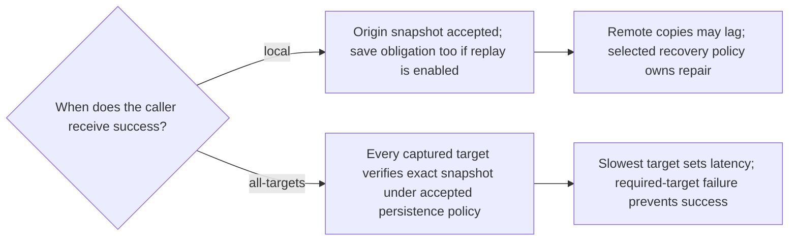

# Redis deployment and distribution options

Status: proposed design; no adapter or distribution worker implemented.

The consistency policy is `latest-local-ryow` for both options. Default latest-local reads honor carried write context; exact and any-version reads remain explicit options. Deployment mode is independent of read policy.

## Options

Replica shards are additional in both modes.

The non-Active-Active option retains the existing Redis Software 8.x product target. This does not establish a separate Redis Open Source compatibility claim. Pin supported commands, persistence, replicas, builds, and database versions for each mode.

Ordinary Redis [primary/replica replication](https://redis.io/docs/latest/operate/oss_and_stack/management/replication/) is asynchronous leader/follower replication; it does not automatically synchronize independent writable regional databases. Local HA replicas remain distinct from the regional fan-out participants. A single-primary cross-region alternative would introduce different write-routing constraints and is outside this proposed independent mode.

See [decisions.md](decisions.md) for the configuration and failure-flow diagrams. Recovery (`request-only` or `durable-replay`) and acknowledgment (`local` or `all-targets`) are separate settings. Recovery must be explicitly selected for independent mode.

## The adapter can write to every region

For independent mode, the adapter can send the same immutable snapshot ID and envelope to every configured regional endpoint. It sends the original snapshot, not a repeated business mutation. A replayed insert verifies identity and digest: identical content is a no-op; different content is an integrity error. It never increments counters independently or allocates a fresh snapshot per destination.

When durable replay is enabled, a per-origin outbox and replay worker are proposed to complete copies after the caller or application process exits. The worker can be packaged with the adapter deployment; it need not be a request-path session service. This adds operational work, not a mandatory extra hop for every read.

In-memory parallel writes do not provide crash-surviving repair: if A succeeds, B fails, and the process exits, nothing would remember the missing copy. When replay is enabled, origin acceptance must atomically bind the snapshot and replay obligation, or use a reviewed equivalent recovery protocol. In the three-shard layout, any Redis-local atomic capture must colocate the relevant session/outbox keys in one slot and use commands verified for the pinned backend. Durable capture and retention must survive the failures promised by the agreed persistence policy. No concrete outbox implementation is selected yet.

With `request-only` recovery, the adapter attempts fan-out within its bounded execution budget and records observable per-target outcomes, but persists no repair obligation. A local acknowledgment may occur before remote attempts finish. Process loss can abandon remaining copies; later caller retries or an operator must reconcile them. This mode explicitly makes no eventual-delivery promise. It remains safe for protected reads by failing when required data is missing, at a cost to availability. A best-effort metric is not durable repair state.

## Acknowledgment policies

Both policies send to all configured targets, potentially starting remote requests immediately. The difference is what the caller waits for. Neither requires a current snapshot to be visible in all regions before any reader can see a partial copy. Neither supplies global latest-state ordering or strict geographic consistency.

For `all-targets`, record the target set and configuration epoch, verify exact content, and never remove a failed target merely because a deadline expires. Timeout is an uncertain/partial outcome; reconcile using the same operation and snapshot identity. Readback alone is not disk durability. A US-only target set would be an explicit geographic policy, not proof that all global regions hold the record. Active-Active mode continues to write once and lets Redis transport the snapshot; do not add independent fan-out of business mutations to its instances.

## Replay, discovery hints, and recovery

Outbox, worker, backlog, and replay-position requirements apply when durable replay is enabled. Request-only mode still needs target catch-up/repair procedures but cannot rely on a retained replay log.

Track per-target delivery independently and retry with bounded backoff. Preserve original absolute expiry rather than extending TTL on each delivery; do not resurrect expired state. Isolate replayed records from origin capture so deliveries are not re-exported in a loop. Detect digest conflicts and surface them instead of overwriting immutable records.

Deliver the snapshot before publishing that destination's local discovery hint. Prevent older deliveries within a proven lineage from rolling its hint back. Define a deterministic candidate rule for incomparable lineages; do not call it a global latest order. The default protected read still checks incorporation against caller context regardless of hint arrival order.

Adding a region requires baseline snapshot catch-up plus replay from a captured position without gaps. Removal, restore, backlog trimming, and origin loss need explicit reconciliation rules. Retain replay data until delivery/recovery obligations are satisfied under the agreed policy; backpressure or reject writes before capacity loss destroys obligations. If transport is disabled or broken, local polling cannot make a missing snapshot appear and eventually returns a freshness error.

## Same device behavior

A writes 42 in Region A. A reads locally with context and sees 42/proven successor. Before fan-out reaches B, Device B without context can see 41 or null. With transferred context, B waits for 42/proven successor or errors. After successful `all-targets` acknowledgment, included targets have verified 42 at that moment, subject to the accepted retention and failure contract; later data loss is still possible. Read policies and authorization rules are unchanged.
