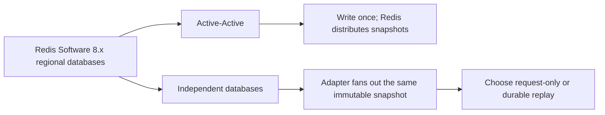
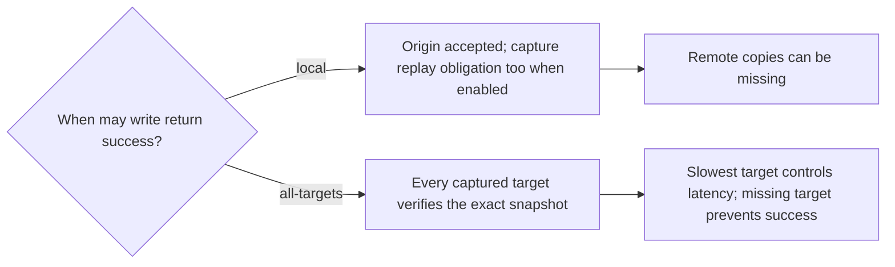

# Distribution, acknowledgment, and recovery

Status: proposed design. [spec.md](spec.md) defines behavior; [decisions.md](decisions.md) diagrams the choices and their benefits/costs. All combinations use Redis Software 8.x with three primary shards per regional database, replicas additional, and the same read-policy interface.

A1/A2 read/write `us-west-2`, B1 reads/writes `us-east-1`, C1 reads/writes `us-east-2`, D1 reads/writes `eu-west-1`, and E1 reads/writes `eu-central-1`. US contains the three US regions; EU contains the two EU regions. Production reads carry no caller write-dependency context. A1/A2 share the example west regional database; the two local clients do not add a target or become separate regional targets. Fan-out targets databases/regions, not clients. It transports stored values between databases.

## Choose distribution

Local and Available reads support either backend. Local reads one cluster; default Available concurrently reads every selected group member, including local, and takes the first non-null value. Read fan-out is separate from write propagation. Active-Active supplies eventual convergence, not linearizability. Causal over Active-Active uses its native causal flag for same-key dependency ordering without regional catch-up. Causal over Coordinated targets that ordering through a custom protocol over independent clusters. Linearizable over Active-Active and Linearizable over Coordinated target the same real-time per-key guarantee; each needs a custom coordination protocol over its respective backend. All adapter/protocol integrations remain proposed or deferred, with no implemented freshness proof. See [infrastructure by consistency level](consistency.md#infrastructure-by-consistency-level).

Active-Active owns CRDT transport and convergence. Do not fan out the same non-idempotent business mutation to its participants. Independent mode disables Active-Active and must supply distribution itself; ordinary [primary/replica replication](https://redis.io/docs/latest/operate/oss_and_stack/management/replication/) does not synchronize independent writable databases. Local HA replicas are not regional delivery targets.

The independent option retains Redis Software 8.x; it does not establish a Redis Open Source support claim. A single-primary cross-region alternative has different write-routing constraints and is outside this proposal.

## Fan-out and acknowledgment

Every independent insert/update identifies its latest version and attempts delivery to all configured targets. Copies reuse its original ID, payload, digest, generation, and absolute expiry. Reapplying identical content is a no-op; conflicting identity/content is an integrity error. Copying must not repeat business-side mutations or trigger recursive re-export.

Local acknowledgment is the baseline. Optional `all-targets` waits for every member captured with the operation's target-set/configuration epoch. A deadline never silently removes a participant. On partial failure, preserve IDs and report an uncertain/partial outcome; existing copies are not rolled back. Readback proves presence under its stated policy, not disk durability. Neither acknowledgment option establishes linearizable geographic ordering or atomic regional visibility.

Target scope is explicit: US-only verification is not verification of every global region. Current local acknowledgment does not wait for group peers or foreign groups. In the five-target sample, all-targets verifies all five; groups do not implicitly reduce this set. A future origin-group-only barrier with foreign asynchronous delivery requires a distinct acknowledgment-set design. Active-Active in this phase uses origin acknowledgment; an adapter verification overlay for that backend is not currently specified.

## Request-only: refresh on the next write

`request-only` attempts delivery during bounded request execution and records observable outcomes without persisting unfinished work. Local success may precede remote completion. Process exit can abandon in-memory attempts.

The next insert/update **for the same session** sends only its latest version to all configured targets. A successful delivery of 43 can refresh B's local state without filling missing historical 42. This is the normal flow; no manual repair step is required. No later write means no further distribution attempt, so an idle session can remain stale.

Local and Available do not require an exact historical identity or caller context. A write for another session does not refresh this session. A later successful write never retroactively acknowledges an uncertain earlier write.

## Durable replay: retain delivery obligations

`durable-replay` is optional. A per-origin outbox and worker preserve unfinished copies so delivery can continue after request-process exit and without another insert/update. The worker may run with the adapter deployment; it need not add a session-service hop to reads.

Before successful acknowledgment, origin acceptance must bind the snapshot and replay obligation atomically, or use an equivalent reviewed recovery protocol. Redis-local atomic capture must colocate the relevant keys in one slot and use commands supported by the pinned deployment. Three primary shards require slot-scoped capture/discovery, not an assumed cross-shard transaction. A concrete mechanism and persistence contract remain unselected.

Track delivery per target, retry with bounded backoff, preserve original expiry, and avoid resurrecting expired state. Retain obligations until the accepted delivery/recovery policy permits removal. Apply backpressure or reject writes before capacity pressure destroys promised obligations. Origin storage loss beyond the agreed durability contract can still lose data or work; replay is not unlimited durability.

Replay can finish a timed-out all-target write, but the original outcome remains uncertain until reconciled with its original IDs. Never report the original write as successful merely because copies might eventually arrive.

## Discovery hints, membership, and restore

At a destination, apply the immutable snapshot before publishing its discovery hint. Use a deterministic, backend-supported candidate/conflict rule and reject conflicting identity/content. A publication timestamp or larger numeric label does not establish global freshness. Local and Available validate candidates without caller write-context checks.

With replay, new-target catch-up requires a baseline plus a captured replay position without gaps; removal and log trimming must reconcile outstanding target obligations. Request-only does not promise historical backfill: admit targets for future latest-version writes and treat absent historical records as missing. A separate baseline/backfill feature would require an explicit scope decision.

Restored targets do not become fresh merely because their endpoint is healthy. Revalidate identity, expiry, and candidate publication. Preserve configuration epochs and distinguish internal expected-copy verification from public Local/Available null results. Endpoint health does not establish current authorization.
