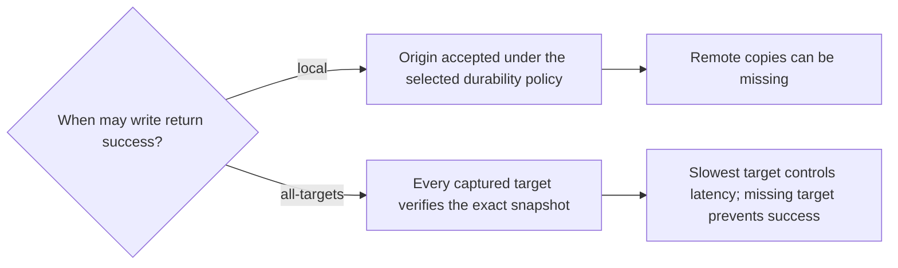

# Distribution, acknowledgment, and recovery

Status: proposed design. [spec.md](spec.md) defines behavior; [decisions.md](decisions.md) diagrams the choices and their benefits/costs. All combinations use Redis Software 8.x with three primary shards per regional database, replicas additional, and the same read-policy interface.

A1/A2 read/write `us-west-2`, B1 reads/writes `us-east-1`, C1 reads/writes `us-east-2`, D1 reads/writes `eu-west-1`, and E1 reads/writes `eu-central-1`. US contains the three US regions; EU contains the two EU regions. Local/Available reads carry no caller write-dependency context. A1/A2 share the example west regional database; the two local clients do not add a target or become separate regional targets. Fan-out targets databases/regions, not clients. It transports stored values between databases.

## Choose distribution

Delivery recovery follows the backend: independent clusters have **no background repair**; Active-Active uses **Redis-managed** replication recovery. Neither is a separate adapter recovery setting. Application outbox capture and replay workers are outside production scope.

Local and Available reads support either backend. Local reads one cluster; default Available concurrently reads every selected group member, including local, and takes the first non-null value. Read fan-out is separate from write propagation. Active-Active supplies eventual convergence, not linearizability. The monotonic modifier is proposed on Local/Available on either backend and requires automatic caller read-history tracking plus proof of acceptable state ordering. Linearizable over Active-Active and Linearizable over Coordinated target the same real-time per-key guarantee through custom protocols. Causal is no longer a read option or custom protocol workstream; Redis's native causal flag remains optional backend configuration. See [infrastructure by consistency level](consistency.md#infrastructure-by-consistency-level).

Active-Active owns CRDT transport and convergence. Do not fan out the same non-idempotent business mutation to its participants. Independent mode disables Active-Active and must supply distribution itself; ordinary [primary/replica replication](https://redis.io/docs/latest/operate/oss_and_stack/management/replication/) does not synchronize independent writable databases. Local HA replicas are not regional delivery targets.

The independent option retains Redis Software 8.x; it does not establish a Redis Open Source support claim. A single-primary cross-region alternative has different write-routing constraints and is outside this proposal.

## Fan-out and acknowledgment

Both future linearizable implementations use **slow++** read and write planning ratings. This is separate from independent all-target placement, which retains its **slow+** write rating and does not establish linearizability. Actual protocol latency remains unmeasured.

The [write behavior table](README.md#write-behavior) summarizes baseline local/all-target acknowledgment and future linearizable commit paths. Only `local` and independent `all-targets` are current proposed acknowledgment settings; custom rows need their own validated protocols, not an extra acknowledgment label. Available has no separate write mode.

Every independent insert/update identifies its latest version and attempts delivery to all configured targets. Copies reuse its original ID, payload, digest, generation, and absolute expiry. Reapplying identical content is a no-op; conflicting identity/content is an integrity error. Copying must not repeat business-side mutations or trigger recursive re-export.

Local acknowledgment is the baseline. Optional `all-targets` waits for every member captured with the operation's target-set/configuration epoch. A deadline never silently removes a participant. On partial failure, preserve IDs and report an uncertain/partial outcome; existing copies are not rolled back. Readback proves presence under its stated policy, not disk durability. Neither acknowledgment option establishes linearizable geographic ordering or atomic regional visibility.

Target scope is explicit: US-only verification is not verification of every global region. Current local acknowledgment does not wait for group peers or foreign groups. In the five-target sample, all-targets verifies all five; groups do not implicitly reduce this set. A future origin-group-only barrier with foreign asynchronous delivery requires a distinct acknowledgment-set design. Active-Active in this phase uses origin acknowledgment; an adapter verification overlay for that backend is not currently specified.

## No background repair for independent clusters

Recovery here means inter-region delivery repair, not local Redis server recovery. Independent clusters do not synchronize automatically. The adapter makes bounded request-time delivery attempts without persisting unfinished work or running a repair worker. Local success may precede remote completion; process exit can abandon in-memory attempts.

Each insert/update **for the same session** sends its current version to all configured targets as normal write fan-out. A successful delivery of 43 can refresh a region without restoring missing historical 42. A different-session write does not refresh this session. Without another write, missed delivery can remain unrepaired indefinitely. A later successful write never retroactively acknowledges an uncertain earlier write.

There is no separate next-write refresh mode or durable replay option. The [Recovery table](README.md#recovery) describes backend behavior. Active-Active owns its replication catch-up; future linearizable protocols must separately define safe commit recovery, authority/fencing, and failover.

## Discovery hints, membership, and restore

At a destination, apply the immutable snapshot before publishing its discovery hint. Use the selected Redis data type's native conflict semantics and supported commands; document those semantics rather than adding a custom conflict-resolution engine. Reject conflicting identity/content during adapter validation. A publication timestamp or larger numeric label does not establish global freshness. Local and Available validate candidates without caller write-context checks.

Independent target admission has no historical-backfill promise: new targets receive future writes. A separate baseline/backfill feature would require an explicit scope decision. Redis-managed Active-Active catch-up follows its backend readiness requirements.

Restored targets do not become fresh merely because their endpoint is healthy. Revalidate identity, expiry, and candidate publication. Preserve configuration epochs and distinguish internal expected-copy verification from public Local/Available null results. Endpoint health does not establish current authorization.

## Backend causal consistency setting

Active-Active can enable native causal consistency to preserve causal dependencies on the same key; disabling it retains eventual convergence without that causal-order guarantee. Neither setting guarantees regional catch-up or caller monotonicity across region changes. Local/Available work with the flag on or off. Monotonic-on Local/Available need their own read-history enforcement on either backend without broadening the base strategy's read scope; both linearizable modes need their own custom protocols. The native flag is configuration, not a public `causal` read behavior. See [Redis causal consistency](https://redis.io/docs/latest/operate/rs/databases/active-active/causal-consistency/).

Local and Available inherit same-key causal operation ordering when Active-Active causal consistency is enabled. This backend ordering does not ensure a region has caught up or prevent a caller from reading older state after switching regions. With monotonic on, both strategies additionally enforce per-caller same-key non-regression using automatic read history; independent clusters need that enforcement too. Neither causal ordering nor monotonic reads guarantees the latest completed write. Same-key Redis ordering must not be assumed to order multiple snapshot/hint keys.
