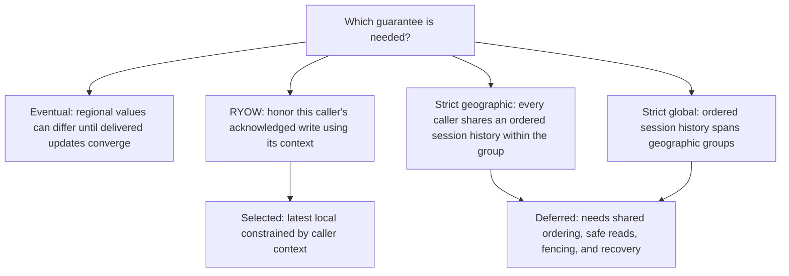
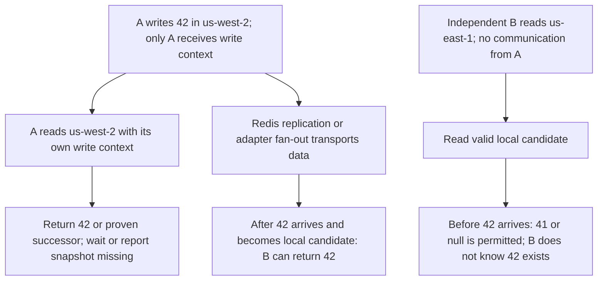

# Consistency and Device A/B behavior

The selected contract is **latest local with read-your-own-writes (RYOW)**, named `latest-local-ryow`. This explains the design; [spec.md](spec.md) defines exact behavior. No adapter has been implemented.

## What the four levels mean

These are the four options discussed, not an exhaustive consistency taxonomy. Active-Active supplies strong eventual convergence; “strong eventual” does not mean strict. Optional causal ordering does not prove that a destination has caught up. See [Active-Active](https://redis.io/docs/latest/operate/rs/databases/active-active/) and [causal consistency](https://redis.io/docs/latest/operate/rs/databases/active-active/causal-consistency/).

Independent request-only fan-out can leave missed versions undelivered. It attempts the next same-session write again; without further writes there is no guaranteed convergence. That limitation is distinct from the adapter's rule that a protected read must not return stale success.

## Agreed scenario

Client A reads and writes in `us-west-2`; client B independently reads and writes in `us-east-1`. Assume A's write of 42 completes before the reads start, and B has no context from a separate B write for this example. B's local database still has 41 or no record. **A and independent reader B do not communicate:** no context transfer, version notification, or shared latest-version directory is assumed. Data can still arrive through Redis replication or adapter fan-out.

B does not wait for an unknown A write or report missing 42. Context errors mean invalid/lost context for an actual requirement, not lack of another caller's context. Exact-version reads remain available to callers with valid known-version context; no handoff feature is included. Expiry, integrity, and infrastructure errors remain distinct from snapshot missing.

Strict geographic differs specifically for B without context: within the same group, a read beginning after completed write 42 must reflect 42 or a later committed update, or fail. Our design permits B's older local state. Across different geographic groups, strict geographic alone does not make foreign projections current.

## Both clients write; defaults are unchanged

If B inserts/updates locally in `us-east-1`, its successful response provides B’s own write context. B’s subsequent default reads must honor that B write or report snapshot missing. A similarly uses its own context in `us-west-2`. Neither client receives the other’s context.

A concurrent B version is not automatically a proven successor to A’s 42. Protected latest uses the existing lineage/provenance rule; it does not invent a global order across the two writers. Independent readers without their own prior-write requirement use local discovery. `latest` remains the default; the region layout does not select a different acknowledgment or recovery mode.

## Latest, exact, and any are read policies

Default `latest` considers the local candidate and checks it against carried context. A proven successor 43 may satisfy context 42. An unrelated device's numeric label 43 is not proof; incomparable histories remain incomparable. During a default wait, recheck eligible candidates as well as exact 42.

Explicit `required` means exactly 42, even if 43 exists. Explicit `any` accepts any valid locally selected version, including older state, and can return null. With genuinely no prior context, default latest also has eventual local discovery semantics. Lost expected context must not become a first read or an implicit any read.

Latest means the locally selected eligible candidate, not a globally ordered maximum across every stored snapshot. “At least 42” would require a proven history relation; a general minimum-version API and global latest discovery are deferred. [decisions.md](decisions.md) diagrams the read flow.

## Next-write refresh and historical gaps

In request-only mode, the next insert/update distributes only its latest version. If B receives proven successor 43 but never receives exact 42, default latest can return 43; exact 42 reports **snapshot missing**. A write for another session does not fill this gap. Durable replay optionally retains original delivery obligations.

Neither replay nor waiting for all target copies creates strict commit ordering. Three primary data shards partition storage, not consistency scope. Snapshot presence and caller context also do not prove current authorization after another device's logout; immediate cross-device revocation requires a separate security contract. See [backends.md](backends.md).
