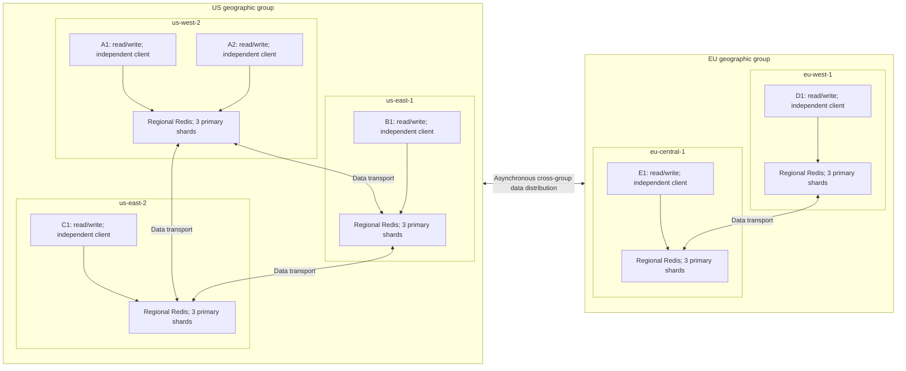

# Consistency and regional read behavior

The production default is **Available** (`available`); **Local** (`local`) is explicit. Session and Causal read options have been removed; an optional monotonic guarantee on Local/Available is proposed. [spec.md](spec.md) owns exact behavior. The [AWS spike](spike/README.md) is a legacy experiment, not the revised production API.

## Separate propagation, reads, and scope

| Question | Choices | Meaning |
| --- | --- | --- |
| How do copies propagate? | Active-Active or independent fan-out | Redis handles eventual transport, or the adapter supplies distribution/recovery. |
| How is a value read? | Local; Available (default) | The base strategy selects one local candidate or a concurrent group race. |
| Which clusters are searched? | Configured read group | US, EU, or an explicitly configured all-five group; membership is captured for each Available request. |
| Is stronger ordering required? | Monotonic on/off modifier for Local/Available; Linearizable over either named backend | Off supplies no caller read-order guarantee; on prevents same-key caller read regression without changing the source scope or creating a global order; Linearizable targets real-time freshness. |

Neither supported read behavior provides RYOW, newest-value selection, or quorum agreement. Available can return a stale first value; timeout-null means no value arrived in time.

## Infrastructure by consistency level

Local and Available work with Active-Active or independent regional clusters. Active-Active provides CRDT replication and strong eventual convergence; independent clusters require application distribution and recovery. Request-only refresh may leave idle regions stale indefinitely without another write.

Active-Active supplies native per-key causal ordering when enabled, not linearizability. Both backends can target caller monotonicity through automatic read-history enforcement, or full linearizability through custom coordination. Both linearizable variants require an additional validated ordering/commit/read/failure protocol; none follows from replication or placement alone. No such custom protocol is implemented. See [Redis Active-Active](https://redis.io/docs/latest/operate/rs/databases/active-active/).

Both Linearizable implementations are rated **slow++** for reads and writes in the planning model. This is the same provisional band on either backend, not a measured latency ranking.

## Main questions and guarantees

| Strategy / optional guarantee | Main question | Guarantee |
| --- | --- | --- |
| Local | Does local have a value? | No read-history/freshness floor. |
| Available | Does any group member have a value? | First valid non-null value, including local; no freshness/history floor. |
| Optional monotonic guarantee (proposed) | Can I read without going backward from what I have seen? | **Last-observed freshness:** same or proven later state than the caller's last tracked successful read, on either backend; no latest-write or time-age bound. |
| Linearizable over Active-Active | Does this read reflect completed writes? | Real-time order/freshness per key in scope, via a custom protocol over Active-Active. |
| Linearizable over Coordinated | Does this read reflect completed writes? | The same guarantee, via a custom protocol over independent clusters. |

After observing 42, Monotonic rejects older 41 but may still return 42 when newest 43 is elsewhere. It needs automatic caller read-history tracking and an accepted ordering/proof relation on both backends. With Local it only searches/rechecks local state; with Available it filters the group race. It provides a last-observed freshness floor, while linearizability requires real-time freshness. It waits/fails if an established floor cannot be honored; Available's deadline-null rule must not silently weaken it. Successful reads with the modifier on establish its floor, not unread writes or untracked off-reads. Turning it off permits base-strategy reads without lowering the retained floor. No Session/RYOW read policy is restored.

Native Active-Active causal consistency remains an optional backend setting. It preserves same-key causal dependencies as data propagates, but can leave a region behind and does not ensure a caller's later regional read meets its previous observed floor. It is not a public read option or a custom causal implementation workstream. See [backend settings](backends.md#backend-causal-consistency-setting).

## Reference topology

The six independent clients write from these regions. Local reads use their regional database; Available reads fan out to the selected group:

- **US group:** A1/A2 in `us-west-2`, B1 in `us-east-1`, C1 in `us-east-2`.
- **EU group:** D1 in `eu-west-1`, E1 in `eu-central-1`.

Clients do not share application write context or a latest-version directory. Local/Available with the modifier off carry no caller history; enabling the proposed modifier adds automatic read-history state. A1/A2 share one logical regional Redis database in this example, with separate application instances. Actual cell/endpoint placement must be confirmed. Five regional databases with three primary shards each mean fifteen primary shards before replicas; six clients do not mean six databases.

Data transport is Redis Active-Active replication or configured independent adapter fan-out, with durable replay optional. The diagram groups regions; it does not specify physical network routing, synchronous write acknowledgment, or cross-client context sharing. Group names do not select an acknowledgment target set. With baseline local acknowledgment, cross-group distribution is outside the write success path.

## A1 writes 42; readers race within a group

A1 and A2 share the west regional candidate but no cross-client freshness guarantee. B1/C1 read US copies; D1/E1 read EU copies. Propagation may leave a region with an older value or null.

For a US Available read, the adapter queries west, east-1, and east-2 concurrently, including its own local cluster. A local null does not stop the east requests. If east-1 returns 41 before west returns 42, 41 wins. If west returns 42 first, 42 wins. No value comparison or cross-region commit discovery is performed. A later result cannot replace a returned value.

| Replies before deadline | Available result |
| --- | --- |
| Local value first | Return local value immediately. |
| Local null, then a remote value | Return that remote value; early null does not win. |
| A stale value, then a newer value | Return the stale first value. |
| Every member returns null | Return null as soon as the last null arrives. |
| No valid value before deadline, including pending/failed members | Return null at deadline; ignore later values. |

Local queries only its own cluster; it returns the local value or null and never launches remote reads. Local infrastructure errors stay errors. Available validates each candidate, continues past failed attempts, and records all-null separately from deadline-null. Request-level authorization/configuration errors stay errors.

## Read groups and write targets

An Available read group includes local and may be geographic or explicitly global. It does not change the write fan-out target set, write acknowledgment policy, or recovery obligations. US-only reads can coexist with all-five-target writes. The group-racing behavior is explicit; Local has no automatic remote fallback.

## Distribution and history

Request-only mode distributes only the next same-session update's latest version; it need not restore missing historical 42 when 43 is delivered. Local/Available read current candidates without requiring either exact identity. Internal placement verification can still describe a known absent copy as **snapshot missing**. Durable replay optionally retains original copy obligations; neither replay nor all-target placement creates linearizability or proves current authorization.
