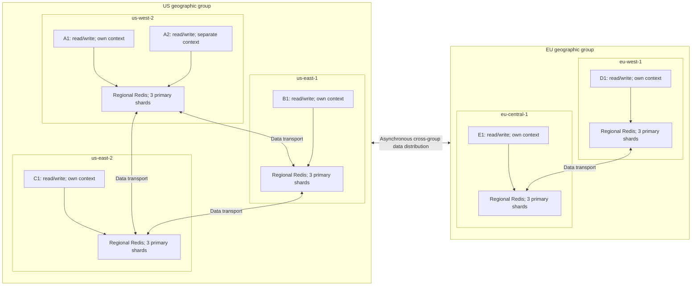

# Consistency and regional client behavior

The selected contract is **Session (RYOW)**, named `session`. This explains the design; [spec.md](spec.md) defines exact behavior. No adapter has been implemented.

## Separate convergence, read consistency, and scope

These are separate design questions, not four mutually exclusive consistency levels. See [README.md](README.md) for the detailed comparison tables.

| Question | Choices | Meaning |
| --- | --- | --- |
| How do regional copies converge? | Eventual propagation | Copies may differ during delivery. Independent clusters require adapter-managed fan-out and recovery. |
| What read behavior or consistency is required? | Available, Session (RYOW), linearizable | Any valid local value or absence; the caller's own acknowledged write or proven successor; or shared per-session ordering for all callers in a selected scope. |
| Which clusters share a linearizable guarantee? | Geographic group, global | A configured regional group, or all five regions across groups. Membership alone does not enforce consistency. |

The selected read behavior is **Session (RYOW)**, named `session`, over asynchronous distribution. It guarantees read-your-own-writes, not full causal consistency. Explicit `available` reads have no freshness guarantee. Linearizable reads are deferred: they require shared ordering, coordinated reads, fencing, and recovery. “Linearizable geographic” and “linearizable global” describe two scopes of that same guarantee, not separate propagation mechanisms or supported read-policy settings. RYOW follows caller context even across groups.

Active-Active supplies strong eventual convergence; “strong eventual” does not mean linearizable. Optional causal ordering does not prove that a destination has caught up. See [Active-Active](https://redis.io/docs/latest/operate/rs/databases/active-active/) and [causal consistency](https://redis.io/docs/latest/operate/rs/databases/active-active/causal-consistency/).

Independent request-only fan-out can leave missed versions undelivered. It attempts the next same-session write again; without further writes there is no guaranteed convergence. That limitation is distinct from the adapter's rule that a protected read must not return stale success.

## Infrastructure by consistency level

Available and Session (RYOW) can use either Redis Software Active-Active or independent regional clusters. Active-Active owns replication, CRDT conflict resolution, and convergence. Independent clusters move those distribution and recovery obligations into the application. RYOW adds caller context and protected-read checks with either backend; asynchronous Active-Active replication alone does not prove that a destination contains the caller's acknowledged write.

For future **linearizable geographic** and **linearizable global** modes, the project direction is to use **Active-Active as the replication base**, avoiding a custom regional replication and convergence implementation. Independent-cluster implementations of those linearizable modes are outside the planned scope. This is an architectural choice to reduce application code, not a claim that Active-Active is mathematically necessary or sufficient for linearizability.

Here, geographic linearizability means linearizability per session key within a geographic group; global linearizability extends that scope across all groups. Both still require a separately designed authority/commit protocol that orders concurrent writes, establishes which state reads may return, fences obsolete writers, and handles partitions and recovery. The strict scope must coordinate or refuse operations when it cannot establish the guarantee. Redis's optional causal ordering does not replace that protocol. No such linearizable overlay is specified, and its compatibility with Active-Active must be validated before implementation.

The [README consistency table](README.md#consistency) summarizes this infrastructure split. The current `session` contract and its two backend choices remain the implementation target.

## Reference topology

The six independent clients read/write locally:

- **US group:** A1/A2 in `us-west-2`, B1 in `us-east-1`, C1 in `us-east-2`.
- **EU group:** D1 in `eu-west-1`, E1 in `eu-central-1`.

No client shares application context, version notifications, or a latest-version directory with another. Each retains context from its own acknowledged writes. A1/A2 share one logical regional Redis database in this example, but not an adapter instance or lineage. Actual cell/endpoint placement must be confirmed. Five regional databases with three primary shards each mean fifteen primary shards before replicas; six clients do not mean six databases.

Data transport is Redis Active-Active replication or configured independent adapter fan-out, with durable replay optional. The diagram groups regions; it does not specify physical network routing, synchronous write acknowledgment, or cross-client context sharing. Group names do not select an acknowledgment target set. With baseline local acknowledgment, cross-group distribution is outside the write success path.

## A1 writes version 42

A1 receives its write context and its own dependent local reads return 42/a proven successor or report snapshot missing. A2 has no knowledge of A1's write requirement. If the shared regional candidate has been published as 42, A2 can read 42 locally without a WAN replication wait. A1's acknowledgment does not by itself guarantee that a best-effort discovery hint was published, nor does it order every concurrent client write; A2 has no independent RYOW requirement for unknown 42.

B1, C1, D1, and E1 each read their own regional database. Before 42 arrives and becomes a local candidate, they may return older local state or null and cannot know 42 exists. Neither waits specifically for A1's unknown version or reports it as missing. After delivery and candidate publication, each can discover 42 locally.

If A2, B1, C1, D1, or E1 makes its own write, its response establishes that client's own RYOW context. A concurrent version from another client is not automatically a proven successor. Sharing a region does not combine A1 and A2 into one lineage or change the default `session` read policy.

## Difference from linearizable geographic consistency

The selected guarantee follows each caller's own context. Linearizable geographic would require every caller in the group, including A2, B1, and C1, to reflect completed write 42 or a later committed update for reads beginning afterward, or fail. It would not rely on A1 notifying them. Our design allows independent readers to see their local candidate without discovering an unpropagated write.

US and EU are separate geographic groups. A hypothetical linearizable-US guarantee would cover A1/A2/B1/C1, not automatically D1/E1. linearizable-EU would cover D1/E1, not automatically US clients. Neither linearizable scope is selected; current reads remain Session (RYOW). Authorization, expiry, integrity, infrastructure failures, and missing expected snapshots remain distinct outcomes.

## Public Session and Available reads; internal version lookup

Default `session` considers the local candidate and checks it against middleware context. A proven successor 43 may satisfy context 42. An unrelated device's numeric label 43 is not proof; incomparable histories remain incomparable. During a wait, recheck eligible candidates as well as the internal exact lookup of 42.

Explicit `available` accepts any valid locally selected candidate, including older state, and can return null. With genuinely no prior context, Session also uses local discovery. Lost expected context must not become a first read or an implicit Available read.

The public API exposes no exact-version selection. Expected versions are internal protected context, and exact-snapshot lookup is a mechanism for enforcing Session reads. Session means locally selected eligible state, not a globally ordered maximum across every stored snapshot. A general minimum-version API and global latest discovery remain deferred. [decisions.md](decisions.md) diagrams the read flow.

## Next-write refresh and historical gaps

In request-only mode, the next insert/update distributes only its latest version. If a client carrying context for 42 receives proven successor 43 but never receives exact 42, Session can return 43. The internal exact lookup of 42 remains absent; report **snapshot missing** only if no eligible snapshot can satisfy the Session read by its deadline. A write for another session does not fill this gap. Durable replay optionally retains original delivery obligations.

Neither replay nor waiting for all target copies creates strict commit ordering. Three primary data shards partition storage, not consistency scope. Snapshot presence and caller context also do not prove current authorization after another device's logout; immediate cross-device revocation requires a separate security contract. See [backends.md](backends.md).
