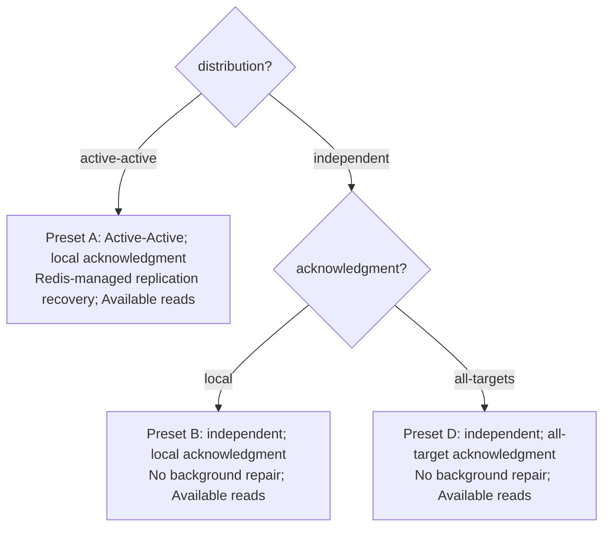
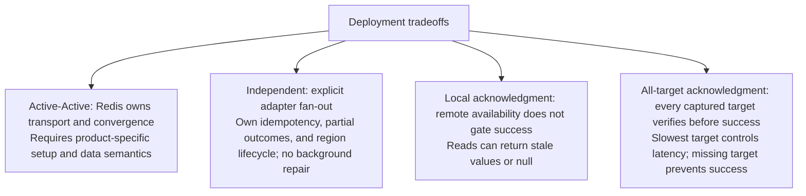
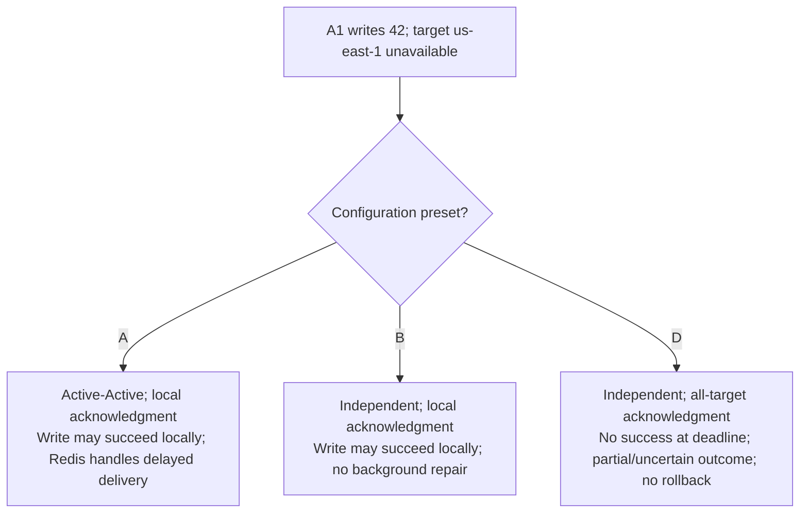
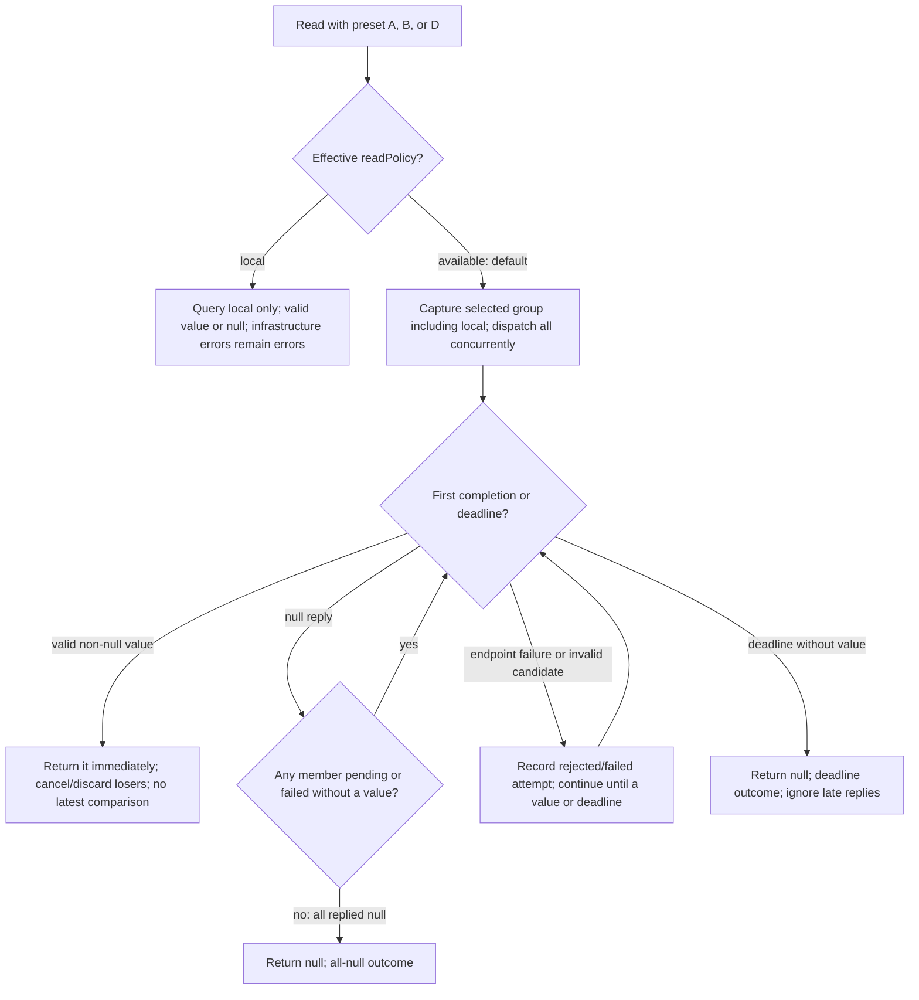

# Deployment and write-policy decisions

Status: proposed production Local/Available API with a legacy AWS spike. Available is default and races the selected group including local; Session reads have been removed. The proposed stronger options are a monotonic on/off modifier for Local/Available on either backend and the two Linearizable backend implementations; implementation/validation remains open. Causal is backend configuration only. Redis Software 8.x targets three primary shards per regional database, plus replicas.

## Selected versus configurable

**Client integration requirement:** Build on top of, or work with, the [official Redis clients](https://redis.io/docs/latest/develop/clients/). Initial targets are **Jedis for Java** and **redis-py for Python**; further official-client integrations must meet the same behavioral contract before support is claimed. Dependency versions and production integration remain to be validated.

**Selected:** `available` by default; explicit `local`; `monotonic: false` by default. Independent clusters have no background repair; Active-Active has Redis-managed replication recovery. Recovery follows the backend and has no separate selector. Neither base read strategy guarantees latest state or caller read-history ordering.

**Still configurable:** distribution and independent acknowledgment. `local` is the baseline acknowledgment; `all-targets` is opt-in. Presets A, B, and D retain their historical identifiers; replay presets C/E belong only to the legacy spike and are outside production scope. Field names remain proposed API concepts, not a shipping SDK schema.

## Choose a configuration and see its outcome



All three presets default to Available. Explicit Local can be used with any preset. Available read groups and write acknowledgment targets remain separate. Active-Active plus adapter all-target acknowledgment is not specified in this phase.

Every independent same-session write distributes its current version as normal fan-out. It need not restore historical gaps. With no later write, a missed delivery can remain unrepaired indefinitely. All-target verification proves placement at acknowledgment, not permanent availability, atomic visibility, or linearizability.

## Benefits and costs of each deployment choice



Distribution and acknowledgment are separate choices. No application outbox capture or repair worker is planned. Local acknowledgment permits incomplete regional delivery; all-target acknowledgment reports partial/uncertain outcomes when required placement cannot be verified. Neither supplies linearizability or current revocation checks. See the [write behavior table](README.md#write-behavior).

## Version 42 when Region B is unavailable

Client A1 in `us-west-2` writes 42 while target `us-east-1`, used by B1, is unavailable. The write deadline is finite, and B remains in the captured all-target set.



Available can find a value in another read-group member, including the origin, but may accept a stale first value or return null at deadline. Local reads only its regional candidate. Each later independent same-session update distributes its current value; it does not retroactively acknowledge an earlier uncertain write.

## Read configuration and outcomes

The effective policy is the request override or configured `readPolicy`, initially `available`. Resolve and capture the selected read group, including local, independently from write targets. Configuration/access failures remain errors. Validate each returned candidate; endpoint failures do not win or cancel healthy attempts.



An early null never wins over a later value within the deadline. Invalid groups/policies and request-level authorization failures do not become null. If a failed member prevents all-null completion and no member returns a value, Available returns null at the shared deadline.

## Estimating p99 for each preset

Use the [p99 estimation model](latency.md) for a selected configuration. A/B acknowledge the origin path; D waits for the slowest required remote verification path. These describe critical paths, not measured rankings.

Local p99 includes one regional lookup. Available value latency follows the first valid non-null response, whereas all-null latency follows the last null response. If no value arrives and a member remains unavailable, the shared deadline bounds the result. Report all-null/deadline-null/error rates beside p99 and avoid adding component p99s or averaging regional p99s. The legacy AWS baseline measures different read controls; it does not predict the new Available race.

## Example code: configuration, writes, and reads

These TypeScript-style snippets are **language-neutral API pseudocode**, not a TypeScript SDK proposal. The adapter builds on top of, or works with, official Redis clients, initially **Jedis for Java** and **redis-py for Python**; language-specific signatures and packaging remain to be defined. No SDK, `createSessionStore` implementation, import package, or executable example exists yet. Endpoint values, groups, and read deadlines come from deployment configuration. Provision Redis Software 8.x with three primary data shards per regional database; shard count is not an adapter setting.

### Configure six clients in US and EU groups: preset B

```ts
const targets = {
  "us-west-2": westEndpoint,
  "us-east-1": east1Endpoint,
  "us-east-2": east2Endpoint,
  "eu-west-1": euWestEndpoint,
  "eu-central-1": euCentralEndpoint,
};

const groups = {
  US: ["us-west-2", "us-east-1", "us-east-2"],
  EU: ["eu-west-1", "eu-central-1"],
};

const configuration = {
  distribution: "independent",
  acknowledgment: "local",
  readPolicy: "available",
  monotonic: false, // Optional guarantee; true needs the proposed history integration.
  targets,
  groups, // Read targets; does not imply a write acknowledgment barrier.
  readGroup: "US", // Example for the west client; select EU for EU clients.
  readDeadlineMs: 100, // Illustrative shared budget, not a measured SLO.
};

// A1 and A2 share the west regional database, but they are separate application clients.
const sessionsA1 = createSessionStore({ ...configuration, localRegion: "us-west-2" });
const sessionsA2 = createSessionStore({ ...configuration, localRegion: "us-west-2" });
const sessionsB1 = createSessionStore({ ...configuration, localRegion: "us-east-1" });
const sessionsC1 = createSessionStore({ ...configuration, localRegion: "us-east-2" });
const sessionsD1 = createSessionStore({ ...configuration, localRegion: "eu-west-1", readGroup: "EU" });
const sessionsE1 = createSessionStore({ ...configuration, localRegion: "eu-central-1", readGroup: "EU" });
```

This selects **configuration preset B**, not client B1. Presets A/B/D describe deployment choices; client names A1/A2/B1/C1/D1/E1 identify callers. Preset D changes acknowledgment to `"all-targets"`. Preset A uses provisioned Active-Active with local acknowledgment. Delivery recovery follows the backend without a recovery selector. Legacy replay presets C/E remain experimental only.

The five regional databases have fifteen primary shards before replicas. A1/A2 share the west regional database, so six clients do not add six regional targets. Baseline local acknowledgment does not wait for either the whole origin group or the foreign group. In this sample, changing acknowledgment to all-targets would verify the five configured targets; a separate origin-group acknowledgment set would need an explicit design choice rather than being inferred from groups.

### Write once; choose a read behavior

```ts
const sessionId = "session-123";
const operationId = crypto.randomUUID(); // Reuse on uncertain retry.
await sessionsA1.put(sessionId, { selectedProfile: "kids" }, operationId);

// Default Available races west, east-1, and east-2, including local west.
await sessionsA1.get(sessionId);
await sessionsA1.get(sessionId, { policy: "available", group: "US" });

// Explicit Local reads west only. Redis/adapter propagation runs separately.
await sessionsA1.get(sessionId, { policy: "local" });

// B1/C1 also race US including themselves; D1/E1 race EU including themselves.
await sessionsB1.get(sessionId);
await sessionsC1.get(sessionId);
await sessionsD1.get(sessionId);
await sessionsE1.get(sessionId);
```

These reads have no caller version/context input. A local null can be followed by a remote value for Available, but the first stale value still wins over a later newer one. If every reply is null, return null; if no value arrives by deadline, return null even when some requests are pending or failed. Return does not wait for loser cleanup. Record the winning region or all-null/deadline reason without logging payloads or bearer identifiers.

Proposed modifier examples (unsupported until the history integration is implemented):

```ts
await sessionsA1.get(sessionId, { policy: "local", monotonic: true });
await sessionsA1.get(sessionId, { policy: "available", monotonic: true });
```

These retain the selected strategy's endpoints. Local never expands into a group search; Available accepts only the first group value satisfying the retained read floor. No floor/version is supplied by business code, and the modifier does not add a write acknowledgment mode.

## Benefits and costs of read strategies and the optional guarantee

| Behavior | Benefit | Cost / limit |
| --- | --- | --- |
| Local | One regional read; avoids WAN read fan-out. | Can miss values present elsewhere; local errors remain errors. |
| Available (default) | Can return a value from any selected group member including local without waiting for agreement. | More requests/connections; can return stale data or deadline-null despite a value elsewhere. |
| Monotonic modifier (proposed) | Prevent a caller's reads moving backward, using automatic read-history tracking on either backend. | Needs accepted state-ordering proofs; may wait/fail; no newest-write or RYOW guarantee. |
| Linearizable over Active-Active | Real-time order and freshness per key in scope. | **slow++** reads and writes; Active-Active plus a custom validated coordination protocol, deferred. |
| Linearizable over Coordinated | The same linearizable guarantee over independent clusters. | **slow++** reads and writes; custom validated ordering/commit/read/failure protocol, proposed and unimplemented. |

Read policy selection never silently changes distribution, acknowledgment, or recovery. The guarantee/backend variants are explicit; reject unimplemented options and backend mismatches instead of falling back to Local/Available. Proposed `monotonic: true` filters/rechecks only local state with Local, or filters the group race with Available against the caller's last successful read floor and requires safe history updates/proofs. Removed `causal`/`causal-coordinated`/Session/exact-version selectors, standalone `monotonic` policy, and ambiguous `coordinated` are not exposed. The modifier defaults to false; an unimplemented true request must error rather than be ignored. Native causal configuration is a backend setting. Authorization, integrity, and expiry still apply. There is no Session policy or public exact-version read. See [spec.md](spec.md), [backends.md](backends.md), and [validation.md](validation.md).
