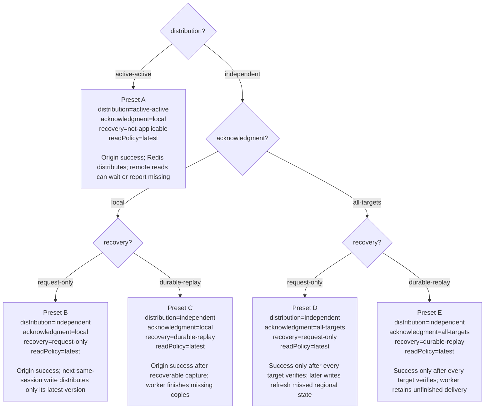
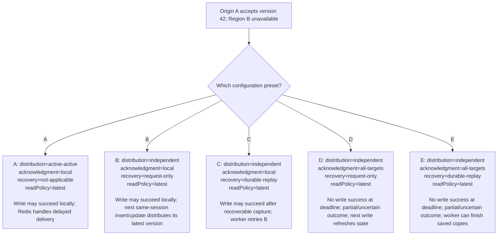
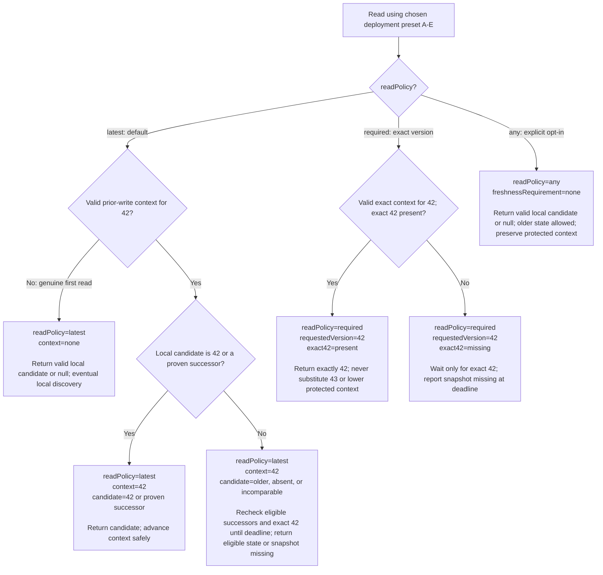
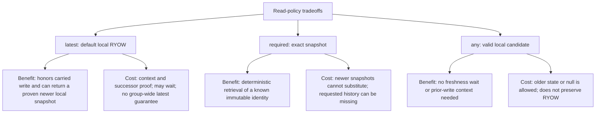

# Deployment and write-policy decisions

Status: design options; no implementation. Read policy remains **latest-local-ryow** by default, with explicit exact-version and any-version reads. Redis Software 8.x uses three primary data shards per regional database, plus replicas.

## Selected versus configurable

**Selected:** the default read policy is `latest` with local RYOW. Redis Software 8.x and three primary shards per regional database are the platform target. Explicit `required` and `any` reads are also available in the design.

**Still configurable:** distribution, independent acknowledgment, and independent recovery. A–E below are configuration presets for explaining outcomes, not a claim that one deployment preset has been chosen. `local` is the baseline acknowledgment; `all-targets` is opt-in. Independent recovery must be chosen explicitly.

Field names are proposed configuration concepts, not a shipping SDK schema. Active-Active's application `recovery` is not applicable: Redis owns transport, so `recovery=not-applicable` below is descriptive rather than an extra SDK setting.

## Choose a configuration and see its outcome

Each leaf contains the complete configuration and the resulting behavior. Preset identifiers stay the same in the failure diagram below.



All five presets default to the same read contract. Either explicit read override can be used with any preset, subject to its context requirements. Active-Active plus adapter `all-targets` is not specified in this phase. Durable replay is optional in independent mode and is not implied by local acknowledgment.

B and D attempt distribution again on the next insert/update for the same session. They send only its latest version, without resending earlier versions. With no later write, a region can remain stale. All-target verification proves placement at acknowledgment under its contract, not permanent availability, atomic visibility, or strict geographic consistency.

## Benefits and costs of each deployment choice

These are design tradeoffs, not measured latency or cost claims. Distribution, acknowledgment, and recovery can be combined; choosing one does not choose the others.

```mermaid
flowchart TD
    Choices["Deployment tradeoffs"] --> AA["Active-Active"]
    AA --> AAPro["Benefit: Redis owns regional transport and conflict convergence"]
    AA --> AACost["Cost: product-specific setup and data semantics; RYOW adapter still required"]
    Choices --> Independent["Independent databases with adapter fan-out"]
    Independent --> IPro["Benefit: explicit destination and delivery control; no Active-Active dependency"]
    Independent --> ICost["Cost: own idempotency, partial outcomes, hint selection, and region lifecycle"]
    Choices --> Local["Local acknowledgment"]
    Local --> LPro["Benefit: remote availability does not gate write success"]
    Local --> LCost["Cost: remote reads may wait or report snapshot missing"]
    Choices --> All["All-target acknowledgment"]
    All --> APro["Benefit: every captured target verifies the snapshot before success"]
    All --> ACost["Cost: slowest target controls latency; one missing target prevents success"]
    Choices --> Request["Request-only recovery"]
    Request --> RPro["Benefit: no durable outbox or replay worker; next write refreshes state"]
    Request --> RCost["Cost: idle sessions can stay stale; missed exact snapshots may remain missing"]
    Choices --> Durable["Durable replay recovery"]
    Durable --> DPro["Benefit: saved delivery resumes after restart without another write"]
    Durable --> DCost["Cost: atomic capture, worker, backlog capacity, retention, and monitoring"]
```



Local + request-only has the least custom recovery machinery among independent options, accepting missed historical delivery. Local + durable replay adds background recovery while keeping remote targets off the success path. All-targets + request-only verifies placement on success but leaves partial writes for subsequent same-session refresh. All-targets + durable replay adds recovery of retained original copies, with both acknowledgment and worker complexity. None of these combinations supplies strict geographic consistency or current revocation checks.

## Version 42 when Region B is unavailable

The setup is identical at every leaf: origin A has accepted 42, B is unavailable, and the configured write deadline is finite. B is in the captured target set for all-targets presets. Partial copies are not rolled back.



For A–C, successful acknowledgment returns context for 42. A later default read carrying that context returns 42/a proven successor, waits, or reports **snapshot missing**. Without transferred context, B can return 41/null while delivery is incomplete.

D–E do not issue normal successful-write context for an uncertain outcome. Authenticated recovery may identify the pending snapshot while preserving that status. A later successful update never retroactively acknowledges the old write. The next diagram applies to reads with valid requirements regardless of which transport preset was used.

## Read configuration and outcomes

`distribution`, `acknowledgment`, and `recovery` remain whichever A–E preset was chosen; they are not silently changed by a read. The leaves below show the effective `readPolicy` and the request inputs that determine each result. Absence and expiry checks assume valid authorization and integrity; invalid/lost expected context, corruption, connectivity, and authentication failures are distinct errors.



An unknown explicit policy is rejected rather than defaulted. A request carrying no context because expected context was lost is also rejected; the first-read leaf is not a silent downgrade path. Explicit expiry uses the separate expired outcome. A higher numeric label alone is not successor proof.

## Estimating p99 for each preset

Use the [p99 estimation model](latency.md) to turn a selected configuration into a client-visible latency estimate. A/B acknowledge the origin path, C additionally requires recoverable capture, and D/E wait for the slowest required remote verification path. These are critical-path descriptions, not measured latency rankings.

Read p99 also depends on policy and context: any/latest-without-context are local candidate paths, while protected latest/required can include residual propagation and polling waits. Request-only misses may wait for a future same-session write; exact missing history may never arrive. Always report timeout/error/missing rates beside p99 and avoid adding component p99 values or averaging regional p99s.

No millisecond values are estimated yet: regional client-side latency distributions, workload/load, capture design, persistence, arrival timing, and deadlines are still needed. See latency.md for formulas, assumptions, the all-target tail effect, and the measurement workflow.

## Example code: configuration, writes, and reads

These TypeScript snippets illustrate the **proposed API**. No SDK, `createSessionStore` implementation, import package, or executable example exists yet. Endpoint values and authenticated context transport come from deployment/middleware integration. Provision Redis Software 8.x with three primary data shards per regional database; shard count is not an adapter setting.

### Configure independent fan-out: preset B

```ts
const targets = {
  "us-east-1": regionAEndpoint,
  "us-west-2": regionBEndpoint,
};

const configuration = {
  distribution: "independent",
  acknowledgment: "local",
  recovery: "request-only",
  readPolicy: "latest", // Store default: latest local + RYOW.
  targets,
};

const sessionsInRegionA = createSessionStore({
  ...configuration,
  localRegion: "us-east-1",
});

const sessionsInRegionB = createSessionStore({
  ...configuration,
  localRegion: "us-west-2",
});
```

This selects **preset B**. To select C, change `recovery` to `"durable-replay"`; select D by changing `acknowledgment` to `"all-targets"`; select E by changing both. Replay needs validated capture/worker configuration in addition to these illustrative fields. Active-Active preset A instead uses `distribution: "active-active"` and `acknowledgment: "local"`, omits application `recovery`, and requires provisioned Active-Active participants; it is not obtained by changing just the distribution field in the independent example.

### Write and read on Device A

```ts
const sessionId = "session-123";
const operationId = crypto.randomUUID(); // Create once; reuse on retry.

const write = await sessionsInRegionA.put(
  sessionId,
  { selectedProfile: "kids" },
  operationId,
);

// Middleware saves the successful write context for dependent reads.
const current = await sessionsInRegionA.get(sessionId, {
  context: write.context,
});
// Omitted policy uses the configured "latest" default.
// Return the written version or a proven local successor;
// otherwise wait within the deadline, then report "snapshot missing".
```

The server issues the actual immutable version identity; 42 in the diagrams is an explanatory label. Do not manufacture context or assume a UUID sorts versions. Partial/uncertain write results do not issue normal successful-write context. Subsequent writes in a lineage carry the middleware's current context through the proposed fourth `put` argument.

### Device B: choose a read policy

`readPolicy` configures the store default; per-call `policy` overrides it. The context below is supplied by authenticated middleware, not copied across caller boundaries without authorization.

```ts
// Genuine first read with no prior-write requirement:
// default latest can return older local state or null.
await sessionsInRegionB.get(sessionId);

// An authorized handoff supplied transferredContext for A's version.
// Latest: return that version or a proven local successor.
await sessionsInRegionB.get(sessionId, {
  policy: "latest",
  context: transferredContext,
});

// Required: return exactly the identity in the context.
// A newer version cannot substitute for a missing exact version.
await sessionsInRegionB.get(sessionId, {
  policy: "required",
  context: transferredContext,
});

// Any: return any valid local candidate, including older state, or null.
// No freshness wait; do not replace the protected context with this result.
await sessionsInRegionB.get(sessionId, {
  policy: "any",
});
```

For protected `latest` and `required` reads, unavailable expected data is reported as **snapshot missing** after bounded waiting. Default latest rechecks eligible successors while waiting; required checks only the exact identity. Infrastructure, integrity, expiry, and context errors remain distinct. Omitting context because required middleware state was lost is not a valid first read or an automatic downgrade.

In request-only mode, the next same-session insert/update distributes **only its latest version** to the configured targets; earlier versions need not be resent. Strict geographic/global latest and a general at-least-version policy are outside this proposed API.

## Benefits and costs of read policies



Authorization, integrity, and expiry checks still apply to every policy. Faster-path implications above describe avoided coordination, not a promised benchmark result.

Do not automatically switch reads or acknowledgment policy after a timeout. Keep operation ID, snapshot ID, target set, and selected policies in sanitized recovery evidence. Neither fan-out nor replay supplies shared strict commit ordering.

A next write of 43 can make B's current state available without filling every historical gap. If exact 42 is absent, report **snapshot missing**. Default latest with context 42 may return 43 only when it is a proven successor; otherwise its required snapshot remains missing. An unrelated session write does not refresh this session. An uncertain all-target write keeps its original outcome; a later successful update does not retroactively acknowledge it.

For protocol obligations and open implementation choices, see [backends.md](backends.md), [spec.md](spec.md), and [validation.md](validation.md).
