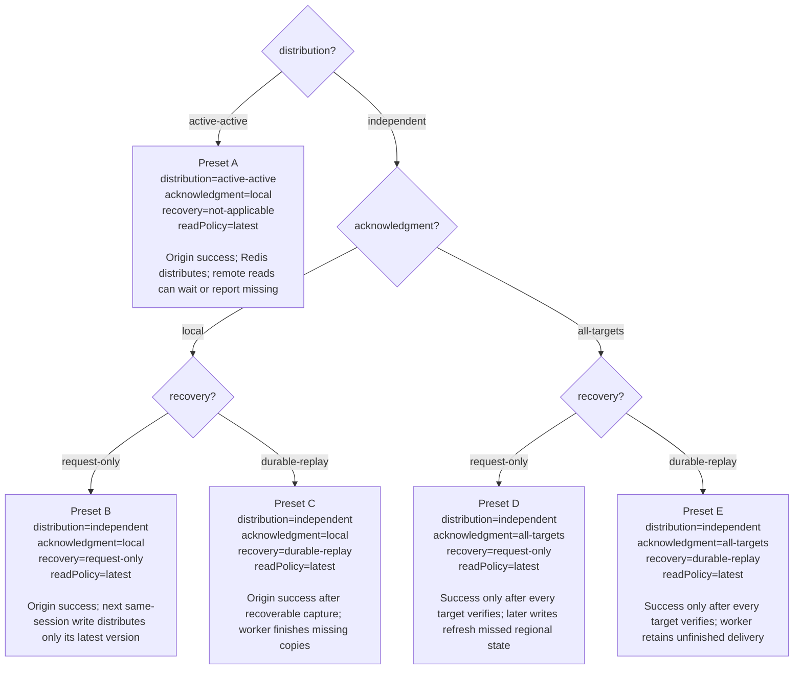
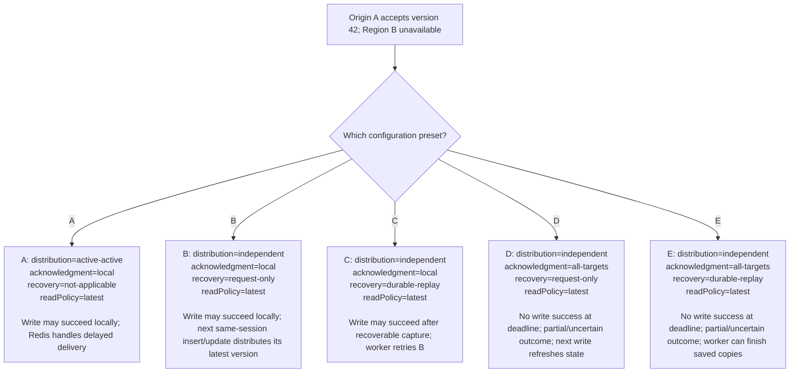
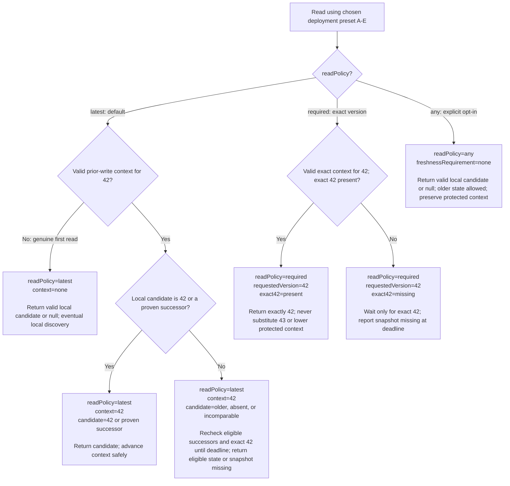
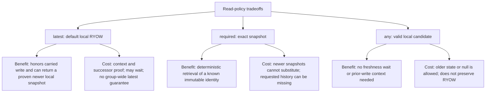

# Deployment and write-policy decisions

Status: design options; no implementation. Read policy remains **latest-local-ryow** by default, with explicit exact-version and any-version reads. Redis Software 8.x uses three primary data shards per regional database, plus replicas.

## Selected versus configurable

**Selected:** the default read policy is `latest` with local RYOW. Redis Software 8.x and three primary shards per regional database are the platform target. Explicit `required` and `any` reads are also available in the design.

**Still configurable:** distribution, independent acknowledgment, and independent recovery. A–E below are configuration presets for explaining outcomes, not a claim that one deployment preset has been chosen. `local` is the baseline acknowledgment; `all-targets` is opt-in. Independent recovery must be chosen explicitly.

Field names are proposed configuration concepts, not a shipping SDK schema. Active-Active's application `recovery` is not applicable: Redis owns transport, so `recovery=not-applicable` below is descriptive rather than an extra SDK setting.

## Choose a configuration and see its outcome

Each leaf contains the complete configuration and the resulting behavior. Preset identifiers stay the same in the failure diagram below.

All five presets default to the same read contract. Either explicit read override can be used with any preset, subject to its context requirements. Active-Active plus adapter `all-targets` is not specified in this phase. Durable replay is optional in independent mode and is not implied by local acknowledgment.

B and D attempt distribution again on the next insert/update for the same session. They send only its latest version, without resending earlier versions. With no later write, a region can remain stale. All-target verification proves placement at acknowledgment under its contract, not permanent availability, atomic visibility, or strict geographic consistency.

## Benefits and costs of each deployment choice

These are design tradeoffs, not measured latency or cost claims. Distribution, acknowledgment, and recovery can be combined; choosing one does not choose the others.

```mermaid
flowchart TD
    Choices["Deployment tradeoffs"] --> AA["Active-Active"]
    AA --> AAPro["Benefit: Redis owns regional transport and conflict convergence"]
    AA --> AACost["Cost: product-specific setup and data semantics; RYOW adapter still required"]
    Choices --> Independent["Independent databases with adapter fan-out"]
    Independent --> IPro["Benefit: explicit destination and delivery control; no Active-Active dependency"]
    Independent --> ICost["Cost: own idempotency, partial outcomes, hint selection, and region lifecycle"]
    Choices --> Local["Local acknowledgment"]
    Local --> LPro["Benefit: remote availability does not gate write success"]
    Local --> LCost["Cost: remote reads may wait or report snapshot missing"]
    Choices --> All["All-target acknowledgment"]
    All --> APro["Benefit: every captured target verifies the snapshot before success"]
    All --> ACost["Cost: slowest target controls latency; one missing target prevents success"]
    Choices --> Request["Request-only recovery"]
    Request --> RPro["Benefit: no durable outbox or replay worker; next write refreshes state"]
    Request --> RCost["Cost: idle sessions can stay stale; missed exact snapshots may remain missing"]
    Choices --> Durable["Durable replay recovery"]
    Durable --> DPro["Benefit: saved delivery resumes after restart without another write"]
    Durable --> DCost["Cost: atomic capture, worker, backlog capacity, retention, and monitoring"]
```

Local + request-only has the least custom recovery machinery among independent options, accepting missed historical delivery. Local + durable replay adds background recovery while keeping remote targets off the success path. All-targets + request-only verifies placement on success but leaves partial writes for subsequent same-session refresh. All-targets + durable replay adds recovery of retained original copies, with both acknowledgment and worker complexity. None of these combinations supplies strict geographic consistency or current revocation checks.

## Version 42 when Region B is unavailable

The setup is identical at every leaf: origin A has accepted 42, B is unavailable, and the configured write deadline is finite. B is in the captured target set for all-targets presets. Partial copies are not rolled back.

For A–C, successful acknowledgment returns context for 42. A later default read carrying that context returns 42/a proven successor, waits, or reports **snapshot missing**. Without transferred context, B can return 41/null while delivery is incomplete.

D–E do not issue normal successful-write context for an uncertain outcome. Authenticated recovery may identify the pending snapshot while preserving that status. A later successful update never retroactively acknowledges the old write. The next diagram applies to reads with valid requirements regardless of which transport preset was used.

## Read configuration and outcomes

`distribution`, `acknowledgment`, and `recovery` remain whichever A–E preset was chosen; they are not silently changed by a read. The leaves below show the effective `readPolicy` and the request inputs that determine each result. Absence and expiry checks assume valid authorization and integrity; invalid/lost expected context, corruption, connectivity, and authentication failures are distinct errors.

An unknown explicit policy is rejected rather than defaulted. A request carrying no context because expected context was lost is also rejected; the first-read leaf is not a silent downgrade path. Explicit expiry uses the separate expired outcome. A higher numeric label alone is not successor proof.

## Benefits and costs of read policies

Authorization, integrity, and expiry checks still apply to every policy. Faster-path implications above describe avoided coordination, not a promised benchmark result.

Do not automatically switch reads or acknowledgment policy after a timeout. Keep operation ID, snapshot ID, target set, and selected policies in sanitized recovery evidence. Neither fan-out nor replay supplies shared strict commit ordering.

A next write of 43 can make B's current state available without filling every historical gap. If exact 42 is absent, report **snapshot missing**. Default latest with context 42 may return 43 only when it is a proven successor; otherwise its required snapshot remains missing. An unrelated session write does not refresh this session. An uncertain all-target write keeps its original outcome; a later successful update does not retroactively acknowledge it.

For protocol obligations and open implementation choices, see [backends.md](backends.md), [spec.md](spec.md), and [validation.md](validation.md).
