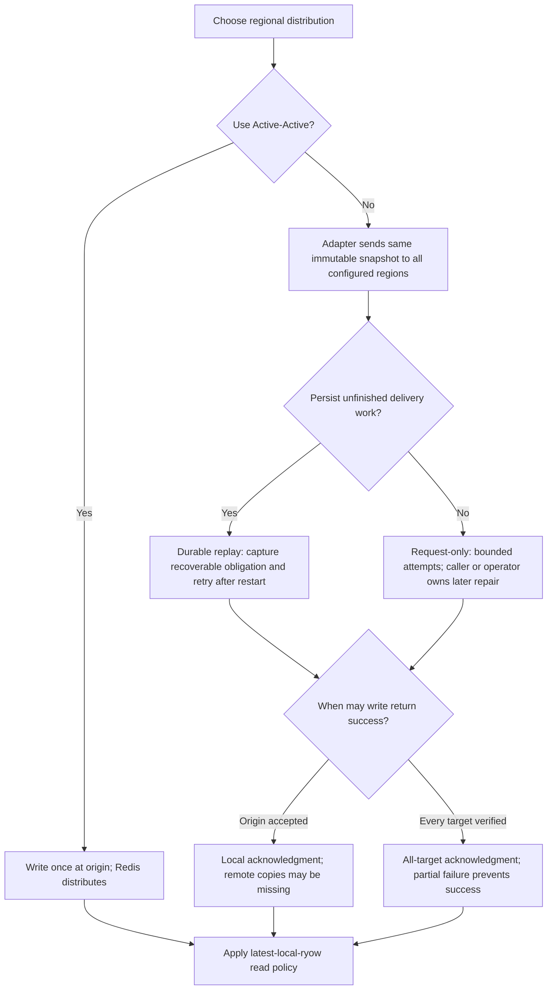
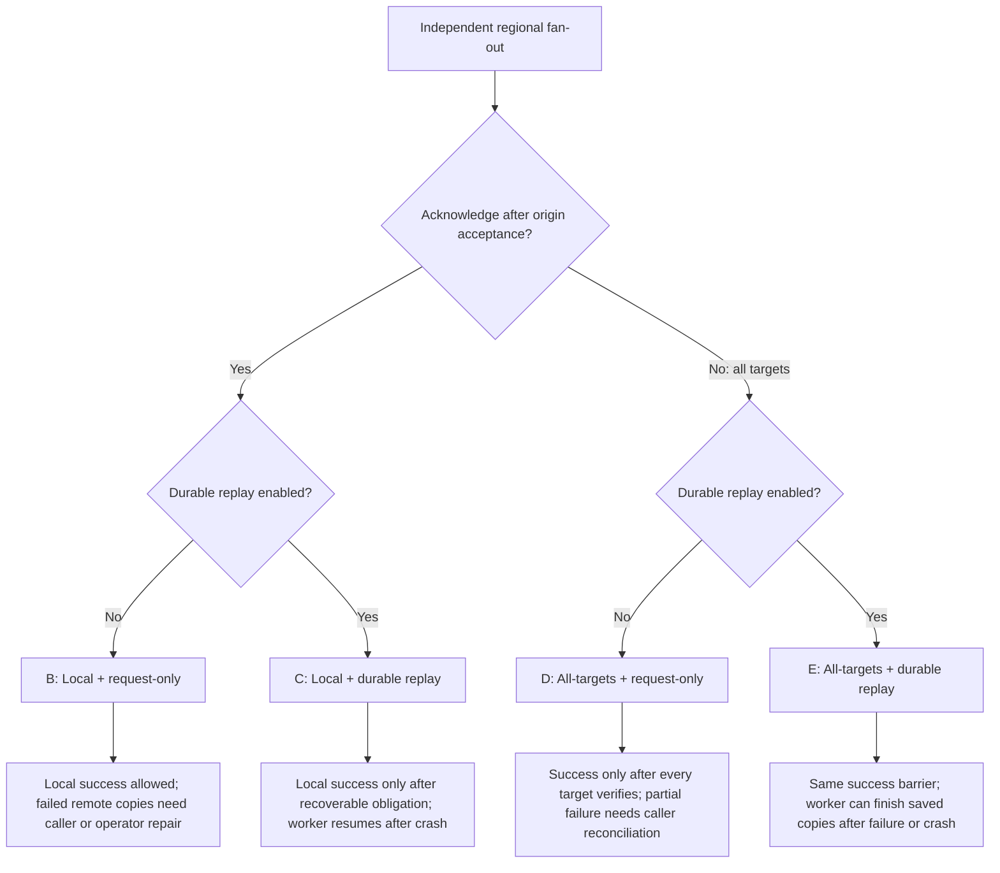
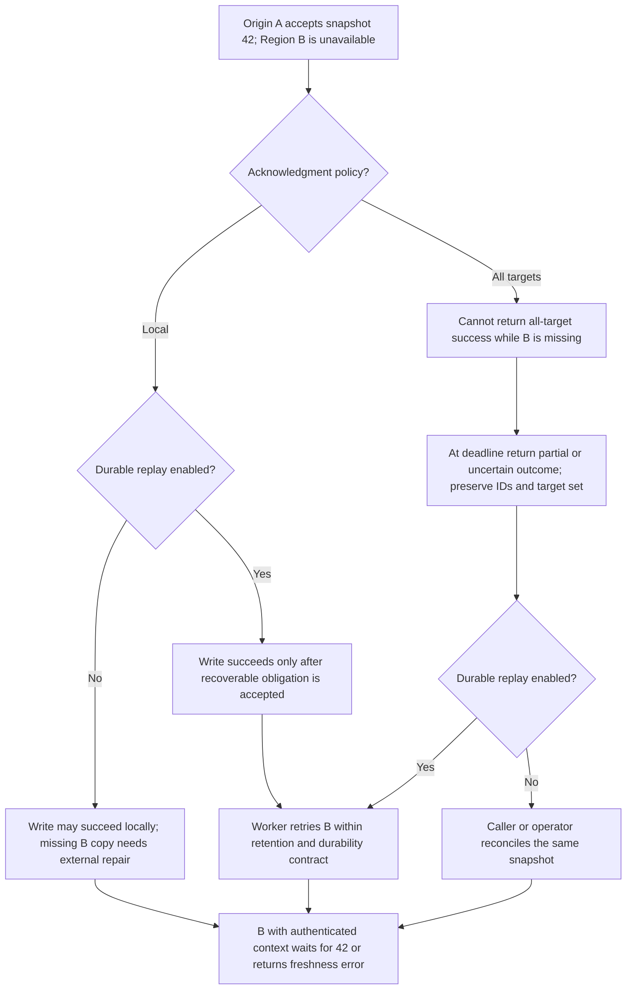
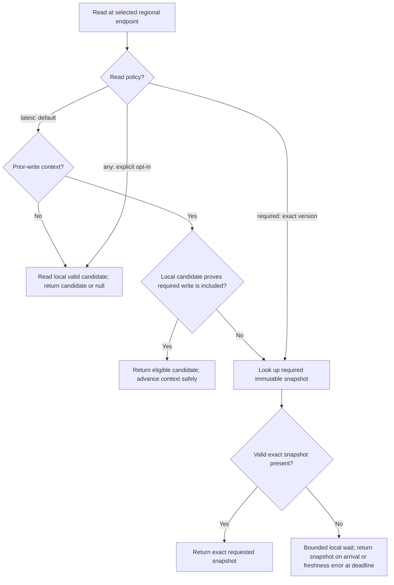

# Deployment and write-policy decisions

Status: design options; no implementation. Read policy remains **latest-local-ryow** by default, with explicit exact-version and any-version reads. Redis Software 8.x uses three primary data shards per regional database, plus replicas.

## Decision flow

Distribution, recovery, and acknowledgment are independent choices. Active-Active's managed replication is not the same as enabling the application's durable outbox. In independent mode, select recovery explicitly; durable replay is optional, not a mandatory or implicitly selected feature. Local acknowledgment remains the baseline; all-target verification is opt-in.

## Write acknowledgment and crash recovery

The four independent-backend combinations share the same immutable fan-out operation. Acknowledgment and recovery are separate settings.

Option A is Active-Active: write once at the origin and let Redis manage transport and recovery under the configured persistence/availability contract. It does not require an application outbox for regional transport.

B and D do not promise eventual regional convergence after a failed copy or process crash. Request-local retries do not survive process loss. A successful all-target write proves placement at acknowledgment under its contract, not permanent availability, rollback of partial copies, or strict geographic consistency.

## Version 42 when Region B is unavailable

Active-Active has the local-acknowledgment behavior with Redis-owned transport rather than the application's replay worker. Without context for 42, B's default latest-local read may return 41 or null while delivery is incomplete. No option automatically transfers A's context to B.

An uncertain write does not issue normal successful-write context. Authenticated recovery/handoff may identify its pending immutable snapshot while preserving the uncertain status until reconciled. Partial errors do not mean existing copies were rolled back.

## Read-policy flow

Authorization, context integrity, generation, and expiry checks apply before successful returns. Invalid or lost expected context is an error, distinct from a genuine first read.

`required` needs authenticated exact-version context; `any` never replaces protected caller context. Infrastructure and integrity failures remain errors rather than null results. An explicitly expired record has the separately defined expired outcome. No flow automatically falls back to an older value after freshness failure.

Do not automatically switch reads or acknowledgment policy after a timeout. Keep operation ID, snapshot ID, target set, and selected policies in sanitized recovery evidence. Neither fan-out nor replay supplies shared strict commit ordering.

For protocol obligations and open implementation choices, see [backends.md](backends.md), [spec.md](spec.md), and [validation.md](validation.md).
