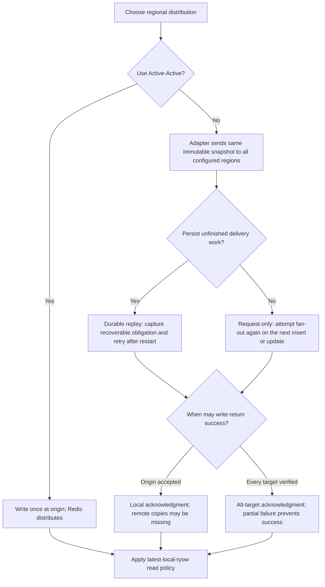
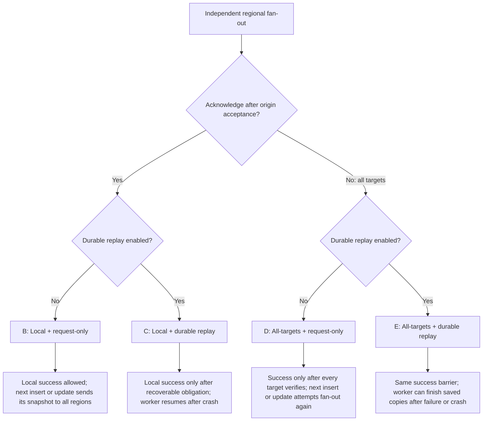
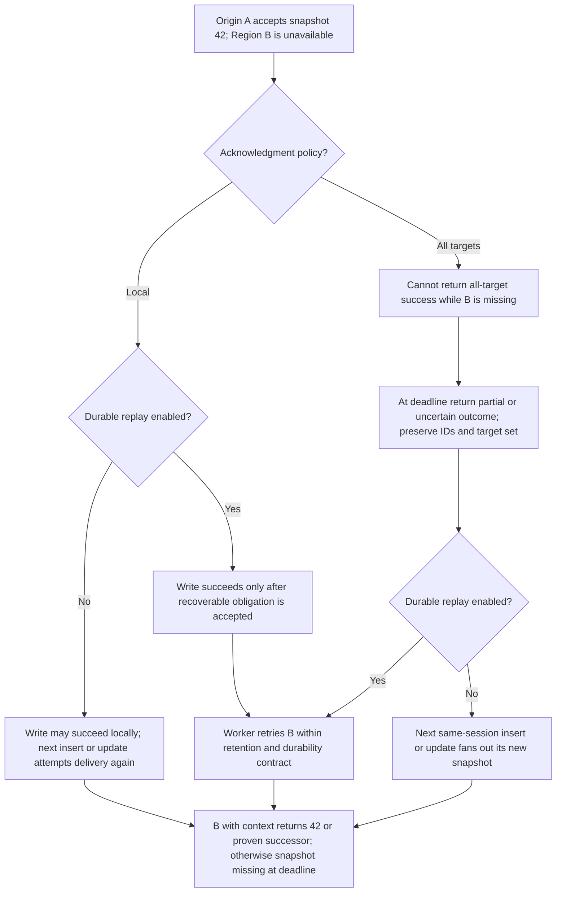
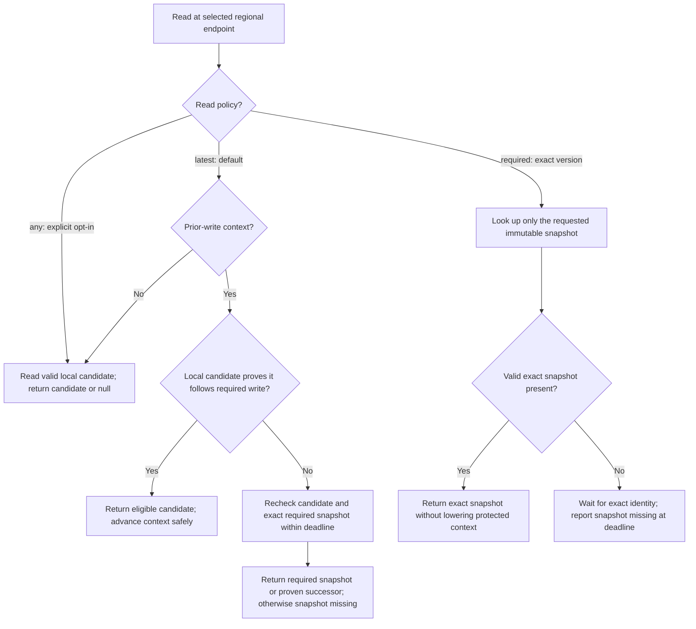
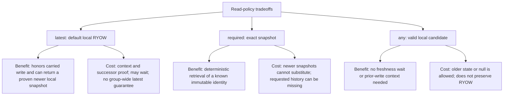

# Deployment and write-policy decisions

Status: design options; no implementation. Read policy remains **latest-local-ryow** by default, with explicit exact-version and any-version reads. Redis Software 8.x uses three primary data shards per regional database, plus replicas.

## Decision flow

Distribution, recovery, and acknowledgment are independent choices. Active-Active's managed replication is not the same as enabling the application's durable outbox. In independent mode, select recovery explicitly; durable replay is optional, not a mandatory or implicitly selected feature. Local acknowledgment remains the baseline; all-target verification is opt-in.

## Write acknowledgment and crash recovery

The four independent-backend combinations share the same immutable fan-out operation. Acknowledgment and recovery are separate settings.

Option A is Active-Active: write once at the origin and let Redis manage transport and recovery under the configured persistence/availability contract. It does not require an application outbox for regional transport.

B and D attempt distribution again on the next insert/update for the same session. Each write distributes only its latest version; a successful later delivery can refresh current local state without replaying earlier versions. With no later write, a region can remain stale. Request-only mode does not retain a crash-surviving historical delivery obligation. A successful all-target write proves placement at acknowledgment under its contract, not permanent availability, rollback of partial copies, or strict geographic consistency.

## Benefits and costs of each deployment choice

These are design tradeoffs, not measured latency or cost claims. Distribution, acknowledgment, and recovery can be combined; choosing one does not choose the others.

```mermaid
flowchart TD
    Choices["Deployment tradeoffs"] --> AA["Active-Active"]
    AA --> AAPro["Benefit: Redis owns regional transport and conflict convergence"]
    AA --> AACost["Cost: product-specific setup and data semantics; RYOW adapter still required"]
    Choices --> Independent["Independent databases with adapter fan-out"]
    Independent --> IPro["Benefit: explicit destination and delivery control; no Active-Active dependency"]
    Independent --> ICost["Cost: own idempotency, partial outcomes, hint selection, and region lifecycle"]
    Choices --> Local["Local acknowledgment"]
    Local --> LPro["Benefit: remote availability does not gate write success"]
    Local --> LCost["Cost: remote reads may wait or report snapshot missing"]
    Choices --> All["All-target acknowledgment"]
    All --> APro["Benefit: every captured target verifies the snapshot before success"]
    All --> ACost["Cost: slowest target controls latency; one missing target prevents success"]
    Choices --> Request["Request-only recovery"]
    Request --> RPro["Benefit: no durable outbox or replay worker; next write refreshes state"]
    Request --> RCost["Cost: idle sessions can stay stale; missed exact snapshots may remain missing"]
    Choices --> Durable["Durable replay recovery"]
    Durable --> DPro["Benefit: saved delivery resumes after restart without another write"]
    Durable --> DCost["Cost: atomic capture, worker, backlog capacity, retention, and monitoring"]
```

Local + request-only has the least custom recovery machinery among independent options, accepting missed historical delivery. Local + durable replay adds background recovery while keeping remote targets off the success path. All-targets + request-only verifies placement on success but leaves partial writes for subsequent same-session refresh. All-targets + durable replay adds recovery of retained original copies, with both acknowledgment and worker complexity. None of these combinations supplies strict geographic consistency or current revocation checks.

## Version 42 when Region B is unavailable

Active-Active has the local-acknowledgment behavior with Redis-owned transport rather than the application's replay worker. Without context for 42, B's default latest-local read may return 41 or null while delivery is incomplete. No option automatically transfers A's context to B.

An uncertain write does not issue normal successful-write context. Authenticated recovery/handoff may identify its pending immutable snapshot while preserving the uncertain status until reconciled. Partial errors do not mean existing copies were rolled back.

## Read-policy flow

Authorization, context integrity, generation, and expiry checks apply before successful returns. Invalid or lost expected context is an error, distinct from a genuine first read.

`required` needs authenticated exact-version context; `any` never replaces protected caller context. Infrastructure, integrity, and context failures remain distinct errors rather than null or snapshot-missing results. An explicitly expired record has the separately defined expired outcome. No flow automatically falls back to an older value after freshness failure.

## Benefits and costs of read policies

Authorization, integrity, and expiry checks still apply to every policy. Faster-path implications above describe avoided coordination, not a promised benchmark result.

Do not automatically switch reads or acknowledgment policy after a timeout. Keep operation ID, snapshot ID, target set, and selected policies in sanitized recovery evidence. Neither fan-out nor replay supplies shared strict commit ordering.

A next write of 43 can make B's current state available without filling every historical gap. If exact 42 is absent, report **snapshot missing**. Default latest with context 42 may return 43 only when it is a proven successor; otherwise its required snapshot remains missing. An unrelated session write does not refresh this session. An uncertain all-target write keeps its original outcome; a later successful update does not retroactively acknowledge it.

For protocol obligations and open implementation choices, see [backends.md](backends.md), [spec.md](spec.md), and [validation.md](validation.md).
