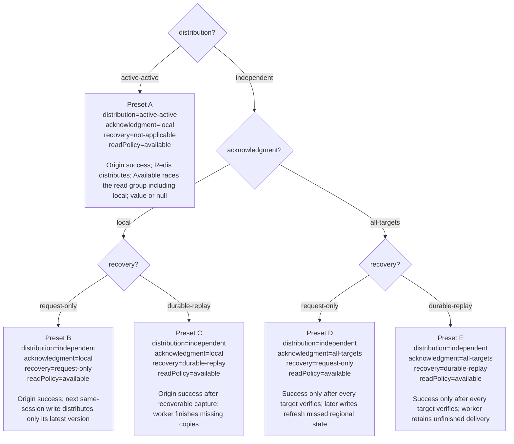

# Deployment and write-policy decisions

Status: proposed production Local/Available API with a legacy AWS spike. Available is default and races the selected group including local; Session reads have been removed. Linearizable reads remain deferred. Redis Software 8.x targets three primary shards per regional database, plus replicas.

## Selected versus configurable

**Selected:** `available` by default; explicit `local`. Available concurrently queries all group clusters including local and returns the first valid non-null value, or null on all-null completion/deadline without a value. Local reads only its regional candidate. Neither enforces RYOW, latest state, or shared ordering.

**Still configurable:** distribution, independent acknowledgment, and independent recovery. A–E below are configuration presets for explaining outcomes, not a claim that one deployment preset has been chosen. `local` is the baseline acknowledgment; `all-targets` is opt-in. Independent recovery must be chosen explicitly.

Field names are proposed configuration concepts, not a shipping SDK schema. Active-Active's application `recovery` is not applicable: Redis owns transport, so `recovery=not-applicable` below is descriptive rather than an extra SDK setting.

## Choose a configuration and see its outcome

Each leaf contains the complete configuration and the resulting behavior. Preset identifiers stay the same in the failure diagram below.



All five presets default to the same Available read contract. Explicit `local` can be used with any preset. Available read groups and write acknowledgment targets remain separate. Active-Active plus adapter `all-targets` is not specified in this phase. Durable replay is optional in independent mode and is not implied by local acknowledgment.

B and D attempt distribution again on the next insert/update for the same session. They send only its latest version, without resending earlier versions. With no later write, a region can remain stale. All-target verification proves placement at acknowledgment under its contract, not permanent availability, atomic visibility, or linearizable geographic consistency.

## Benefits and costs of each deployment choice

These are design tradeoffs, not measured latency or cost claims. Distribution, acknowledgment, and recovery can be combined; choosing one does not choose the others.

```mermaid
flowchart TD
    Choices["Deployment tradeoffs"] --> AA["Active-Active"]
    AA --> AAPro["Benefit: Redis owns regional transport and conflict convergence"]
    AA --> AACost["Cost: product-specific setup and data semantics; group-racing Available still requires adapter fan-out"]
    Choices --> Independent["Independent databases with adapter fan-out"]
    Independent --> IPro["Benefit: explicit destination and delivery control; no Active-Active transport dependency"]
    Independent --> ICost["Cost: own idempotency, partial outcomes, hint selection, and region lifecycle"]
    Choices --> Local["Local acknowledgment"]
    Local --> LPro["Benefit: remote availability does not gate write success"]
    Local --> LCost["Cost: reads may return old values or null"]
    Choices --> All["All-target acknowledgment"]
    All --> APro["Benefit: every captured target verifies the snapshot before success"]
    All --> ACost["Cost: slowest target controls latency; one missing target prevents success"]
    Choices --> Request["Request-only recovery"]
    Request --> RPro["Benefit: no durable outbox or replay worker; next write refreshes state"]
    Request --> RCost["Cost: idle sessions can stay stale; missed exact snapshots may remain missing"]
    Choices --> Durable["Durable replay recovery"]
    Durable --> DPro["Benefit: saved delivery resumes after restart without another write"]
    Durable --> DCost["Cost: atomic capture, worker, backlog capacity, retention, and monitoring"]
```



Local + request-only has the least custom recovery machinery among independent options, accepting missed historical delivery. Local + durable replay adds background recovery while keeping remote targets off the success path. All-targets + request-only verifies placement on success but leaves partial writes for subsequent same-session refresh. All-targets + durable replay adds recovery of retained original copies, with both acknowledgment and worker complexity. None of these combinations supplies linearizable geographic consistency or current revocation checks.

## Version 42 when Region B is unavailable

The setup is identical at every leaf: client A1 in `us-west-2` has written 42, target `us-east-1` used by B1 is unavailable, and the configured write deadline is finite. B is in the captured target set for all-targets presets. Partial copies are not rolled back.


For A–C, local success permits regional lag. Available can still find a value in another member of its read group, including the origin, but it accepts a stale first value and may return null at deadline. Local reads only their regional candidate. D–E report partial/uncertain write outcomes when a required target does not verify; copies are not rolled back and later updates do not retroactively acknowledge that write.

## Read configuration and outcomes

The effective policy is the request override or configured `readPolicy`, initially `available`. Resolve and capture the selected read group, including local, independently from write targets. Configuration/access failures remain errors. Validate each returned candidate; endpoint failures do not win or cancel healthy attempts.


An early null never wins over a later value within the deadline. Invalid groups/policies and request-level authorization failures do not become null. If a failed member prevents all-null completion and no member returns a value, Available returns null at the shared deadline.

## Estimating p99 for each preset

Use the [p99 estimation model](latency.md) to turn a selected configuration into a client-visible latency estimate. A/B acknowledge the origin path, C additionally requires recoverable capture, and D/E wait for the slowest required remote verification path. These are critical-path descriptions, not measured latency rankings.

Local p99 includes one regional lookup. Available value latency follows the first valid non-null response, whereas all-null latency follows the last null response. If no value arrives and a member remains unavailable, the shared deadline bounds the result. Report all-null/deadline-null/error rates beside p99 and avoid adding component p99s or averaging regional p99s. The legacy AWS baseline measures different read controls; it does not predict the new Available race.

## Example code: configuration, writes, and reads

These TypeScript snippets illustrate the **proposed API**. No SDK, `createSessionStore` implementation, import package, or executable example exists yet. Endpoint values, groups, and read deadlines come from deployment configuration. Provision Redis Software 8.x with three primary data shards per regional database; shard count is not an adapter setting.

### Configure six clients in US and EU groups: preset B

```ts
const targets = {
  "us-west-2": westEndpoint,
  "us-east-1": east1Endpoint,
  "us-east-2": east2Endpoint,
  "eu-west-1": euWestEndpoint,
  "eu-central-1": euCentralEndpoint,
};

const groups = {
  US: ["us-west-2", "us-east-1", "us-east-2"],
  EU: ["eu-west-1", "eu-central-1"],
};

const configuration = {
  distribution: "independent",
  acknowledgment: "local",
  recovery: "request-only",
  readPolicy: "available",
  targets,
  groups, // Read targets; does not imply a write acknowledgment barrier.
  readGroup: "US", // Example for the west client; select EU for EU clients.
  readDeadlineMs: 100, // Illustrative shared budget, not a measured SLO.
};

// A1 and A2 share the west regional database, but they are separate application clients.
const sessionsA1 = createSessionStore({ ...configuration, localRegion: "us-west-2" });
const sessionsA2 = createSessionStore({ ...configuration, localRegion: "us-west-2" });
const sessionsB1 = createSessionStore({ ...configuration, localRegion: "us-east-1" });
const sessionsC1 = createSessionStore({ ...configuration, localRegion: "us-east-2" });
const sessionsD1 = createSessionStore({ ...configuration, localRegion: "eu-west-1", readGroup: "EU" });
const sessionsE1 = createSessionStore({ ...configuration, localRegion: "eu-central-1", readGroup: "EU" });
```

This selects **configuration preset B**, not client B1. Presets A–E describe deployment choices; client names A1/A2/B1/C1/D1/E1 identify independent callers. To select preset C, use `recovery: "durable-replay"`; preset D changes acknowledgment to `"all-targets"`; preset E changes both. Replay also needs validated capture/worker setup. Preset A uses provisioned Active-Active, local acknowledgment, and no application recovery setting.

The five regional databases have fifteen primary shards before replicas. A1/A2 share the west regional database, so six clients do not add six regional targets. Baseline local acknowledgment does not wait for either the whole origin group or the foreign group. In this sample, changing acknowledgment to all-targets would verify the five configured targets; a separate origin-group acknowledgment set would need an explicit design choice rather than being inferred from groups.

### Write once; choose a read behavior

```ts
const sessionId = "session-123";
const operationId = crypto.randomUUID(); // Reuse on uncertain retry.
await sessionsA1.put(sessionId, { selectedProfile: "kids" }, operationId);

// Default Available races west, east-1, and east-2, including local west.
await sessionsA1.get(sessionId);
await sessionsA1.get(sessionId, { policy: "available", group: "US" });

// Explicit Local reads west only. Redis/adapter propagation runs separately.
await sessionsA1.get(sessionId, { policy: "local" });

// B1/C1 also race US including themselves; D1/E1 race EU including themselves.
await sessionsB1.get(sessionId);
await sessionsC1.get(sessionId);
await sessionsD1.get(sessionId);
await sessionsE1.get(sessionId);
```

These reads have no caller version/context input. A local null can be followed by a remote value for Available, but the first stale value still wins over a later newer one. If every reply is null, return null; if no value arrives by deadline, return null even when some requests are pending or failed. Return does not wait for loser cleanup. Record the winning region or all-null/deadline reason without logging payloads or bearer identifiers.

## Benefits and costs of read policies

| Behavior | Benefit | Cost / limit |
| --- | --- | --- |
| Local | One regional read; avoids WAN read fan-out. | Can miss values present elsewhere; local errors remain errors. |
| Available (default) | Can return a value from any selected group member including local without waiting for agreement. | More requests/connections; can return stale data or deadline-null despite a value elsewhere. |
| Linearizable (deferred) | Would supply real-time ordering per key within its scope. | No validated protocol; Active-Active alone does not supply it. |

Read policy selection never silently changes distribution, acknowledgment, or recovery. Authorization, integrity, and expiry still apply. There is no Session policy or public exact-version read. See [spec.md](spec.md), [backends.md](backends.md), and [validation.md](validation.md).
