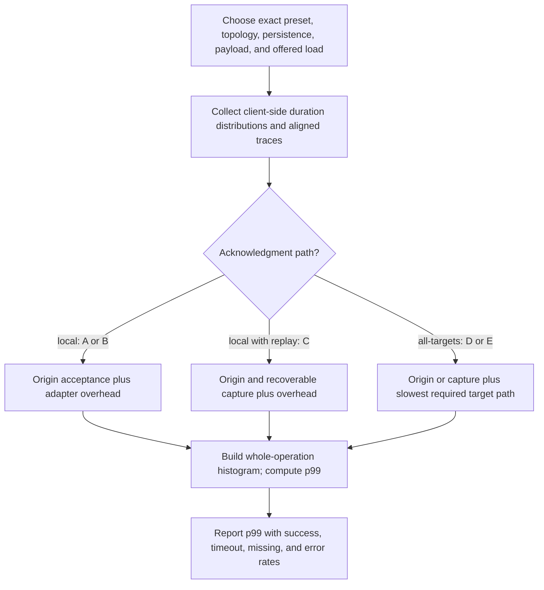

# Estimating p99 latency

Status: planning model with an [experimental AWS measurement harness](spike/README.md). The [2026-11-09 baseline](spike/reports/aws-baseline-20261109.md) records real run results with sample counts and configuration; no production SLO or strict-consistency guarantee is inferred. Presets A–E and read policies refer to [decisions.md](decisions.md). This model does not select a deployment preset.

## Measure the right operation

Measure from application invocation to its returned result, including middleware, pool queues, Redis/network work, context handling, retries, verification, and waiting. Report write acknowledgment, read response, and background delivery separately. A server command benchmark does not measure the proposed adapter's RYOW or fan-out path. Redis's [benchmarking guidance](https://redis.io/docs/latest/operate/oss_and_stack/management/optimization/benchmarks/) discusses workload/client effects; its [latency guidance](https://redis.io/docs/latest/operate/oss_and_stack/management/optimization/latency/) distinguishes client/network and server sources of delay. Neither supplies this deployment's p99.

Produce per-origin/per-destination results at specified offered load and payload size. Separate successful responses, snapshot-missing outcomes, other errors, and all-attempt latency. Report success/error/timeout rates next to p99; fast failures or success-only histograms can hide poor availability. Also measure write-to-first-dependent-read latency: local acknowledgment can move delay from the write into a later read.

## Request-path model

The following variables are **per-request durations or random variables**, not p99 values to add:

- `H`: adapter/middleware/client overhead, including pool waiting and context processing not counted below.
- `O`: accepted local origin write under its chosen persistence policy.
- `C`: accepted origin write plus recoverable replay capture. Treat this as one measured path; atomic capture may share work/round trips with the write.
- `D_i`: time from fan-out dispatch until target i satisfies its exact-record verification/persistence contract. Include network transfers, command phases, connection queues, retries, and application verification.
- `J_i`: dispatch delay before target i's attempt, such as worker backlog or request scheduling.
- `R`: the actual local read/proof path; hint lookup plus exact lookup can require multiple calls.

A simple planning timeline accepts origin/capture first and then dispatches remote copies in parallel. Under that explicit scheduling assumption:

```text
A: active-active + local                  T_write = H + O_A
B: independent + local + request-only     T_write = H + O_B
C: independent + local + durable-replay   T_write = H + C
D: independent + all-targets + request    T_write = H + O_B + max_i(J_i + D_i)
E: independent + all-targets + replay     T_write = H + C   + max_i(J_i + D_i)
```

For D/E, i ranges over required remote targets; origin acceptance is already included. Different builds/modes/load can change O, so A and B are not assumed equal. For C/E, an external capture store could add phases; an atomic local outbox could share one path. E may dispatch directly or through its worker; measure the chosen path, including backlog when applicable.

If an implementation overlaps capture, origin writes, and remote attempts, model its traced dependency graph rather than adding durations that overlap. D_i includes the supported write-and-verify protocol; it is not necessarily one WAN RTT. An extra sequential verification phase can change the estimate materially.



Background transport still consumes resources in A–C and can increase origin queueing under load. Durable replay is not free merely because the worker is outside the acknowledgment path.

## Read-policy model

A1/A2 read/write locally in `us-west-2`, B1 in `us-east-1`, C1 in `us-east-2`, D1 in `eu-west-1`, and E1 in `eu-central-1`, without cross-client communication. Measure each client’s own protected reads separately from its discovery of another client’s updates. A1-to-A2 visibility on the shared regional database includes local candidate publication/read timing, not a WAN replication delay. B1/C1/D1/E1 visibility also includes regional delivery and candidate publication. Readers with no own requirement do not wait for unknown updates; protected reads refer to a caller carrying context from its own writes. Do not assign A1’s freshness requirement or propagation wait to A2/B1/C1/D1/E1 automatically. US groups the three US regions and EU groups the two EU regions. With five configured targets, all-target fan-out has four remote target paths from the origin, including cross-group links. Local acknowledgment does not wait for those links. An origin-group-only barrier is not assumed; its p99 would require a separate participant-set definition. A2 is not a sixth database target.

**Default latest, no prior-write context:** local candidate read and validation. There is no freshness wait, but candidate absence can return null. Do not describe this as cross-device latest discovery.

**Default latest with context:** read/validate the local candidate. If it is ineligible, check the required exact identity and keep rechecking candidates plus exact identity until eligible data arrives or the deadline expires. A proven successor can satisfy the read even when the original version is missing.

**Required:** read/validate only the exact identity and wait for it if absent. A newer version cannot shorten the wait for missing exact 42.

**Any:** read/validate a local candidate without the prior-write freshness requirement. Older state/null is allowed. Authorization, integrity, pool delays, and Redis access still cost time.

For protected latest/required reads, the observed duration is the local work plus any **residual** arrival delay and polling detection cost, bounded by the configured request budget. Residual means delay still remaining when the read begins, not full replication time since the write. Model the actual polling/backoff schedule: detection delay need not be uniformly distributed.

Measure eligible arrival differently by mode: Active-Active transport delay for A, request fan-out completion for B/D, and capture/worker/fan-out delay for C/E. With request-only, a missed original copy may never arrive. A later same-session insert/update can provide an eligible successor for latest; its interarrival and delivery times depend on that session's workload. Exact missing 42 still reports snapshot missing. Without further writes there is no finite guaranteed recovery delay to insert into a p99 model.

## Why component p99 values cannot simply be added

Compute `p99(T_write)` from whole-operation samples or simulated per-request samples. In general:

```text
p99(X + Y) != p99(X) + p99(Y)
p99(max(X_1, ..., X_n)) != max(p99(X_1), ..., p99(X_n))
```

Preserve correlations: regional congestion, shared links, origin stalls, three-shard skew, and worker backlog can affect several stages/targets together. Resampling each component independently can understate shared tail events. Use aligned traces where possible; otherwise label the independence/correlation assumptions and vary them in sensitivity analysis.

For illustration only, if n target durations are independent and identically distributed with CDF F, the all-target completion CDF is `F(t)^n`. With four remote targets, its p99 corresponds to approximately the per-target **99.749th percentile**, even before origin/capture time. This is a mathematical example, not an assumption that the reference regional latencies are identical or independent.

Where only marginal percentiles exist, a conservative budget can use the union bound: allocate stage tail probabilities epsilon_j with sum at most 0.01; sum the corresponding stage quantiles along each sequential path. This can be loose, and component p99 values alone are insufficient for a reliable end-to-end estimate.

## Timeouts, load, and three shards

If more than about 1% of requests run to a configured freshness or write deadline, the all-attempt p99 will tend toward that deadline, plus cancellation/return overhead. Report that as timeout-limited behavior, not successful service latency. Early infrastructure failures may produce a different distribution. Never omit timed-out attempts from the availability report.

Use realistic arrivals and concurrency. A load generator that waits for every response before issuing another request can reduce offered load during a stall and hide queueing; record scheduled arrivals and load-generator saturation. Include payload/token size, TLS, persistence settings, background replay/replication, hot keys, and skew across all three primary shards. Three shards do not divide per-request latency by three; an individual session is mapped to its shard.

Test healthy, delayed, partitioned, backlogged, and post-restore conditions separately. Define whether the service-level result is per region, per configuration, or a production-traffic-weighted mixture; do not average regional p99s to obtain a combined p99. Build the combined histogram at the intended traffic weights instead.

## Inputs needed for useful numeric estimates

Collect origin acceptance and capture distributions, per-target end-to-end write/verification samples, client-side read/proof samples, eligible-record arrival delay, polling schedules, deadlines, read-after-write timing, same-session update intervals, configuration/region traffic shares, and sustained/burst workload profiles. Record exact builds, persistence, capacity, payloads, and shard distribution with the samples.

First compare the symbolic paths above. Next construct estimates from measured aligned traces or a clearly labeled simulation and give sensitivity ranges/confidence intervals. Finally validate with the real adapter at target load. Report each result with preset A–E, origin, destination, read policy/context condition, acknowledgment/recovery, outcome rates, and evidence source. Until these inputs exist, no preset has an honest numerical p99 prediction.
