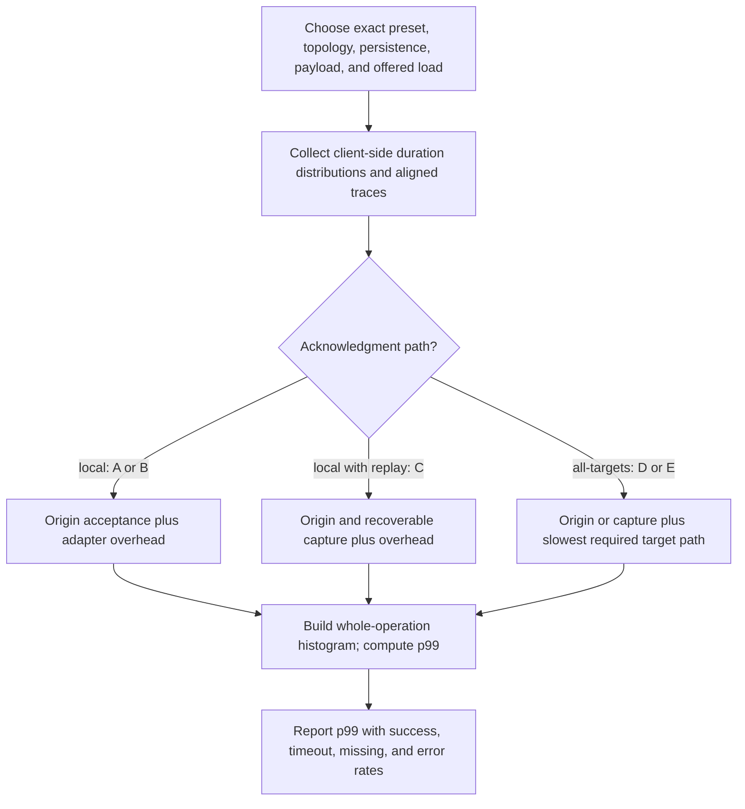

# Estimating p99 latency

Status: planning model with an [experimental AWS measurement harness](spike/README.md). The [2026-11-09 baseline](spike/reports/aws-baseline-20261109.md) records real run results with sample counts and configuration; no production SLO or strict-consistency guarantee is inferred. Presets A–E and read policies refer to [decisions.md](decisions.md). This model does not select a deployment preset.

## Qualitative latency labels

The README uses four planning bands: **fast** for a regional path, **slow** for a remote-response path, **slow+** for inter-region coordination, and **slow++** for extra sequential WAN coordination or reaching the configured deadline. These are shorthand for assumed request paths, not measured milliseconds, fixed bounds, or guaranteed rankings.

Under local acknowledgment, Local reads/writes are provisionally fast. Available reads are provisionally slow, but local winners can be fast and no-value deadlines slow++; its baseline writes remain fast. Monotonic and both Linearizable variants provisionally use slow+ for both reads and writes, assuming inter-region coordination; their unselected protocols could add slow++ paths or optimize some operations. All-target writes add remote waits. Revisit ratings after protocol selection and real measurements.

## Measure the right operation

Measure from application invocation to its returned result, including middleware, pool queues, Redis/network work, group dispatch, retries, verification, and waiting. Report write acknowledgment, read response, and background delivery separately. A server command benchmark does not measure the proposed adapter's group-read or write fan-out path. Redis's [benchmarking guidance](https://redis.io/docs/latest/operate/oss_and_stack/management/optimization/benchmarks/) discusses workload/client effects; its [latency guidance](https://redis.io/docs/latest/operate/oss_and_stack/management/optimization/latency/) distinguishes client/network and server sources of delay. Neither supplies this deployment's p99.

Produce per-origin/per-destination results at specified offered load and payload size. Separate successful responses, all-null and deadline-null outcomes, other errors, and all-attempt latency. Report success/error/timeout rates next to p99; fast failures or success-only histograms can hide poor availability. Also measure write-to-subsequent-read latency: local acknowledgment can move delay from the write into a later read.

## Request-path model

The following variables are **per-request durations or random variables**, not p99 values to add:

- `H`: adapter/middleware/client overhead, including pool waiting and group dispatch not counted below.
- `O`: accepted local origin write under its chosen persistence policy.
- `C`: accepted origin write plus recoverable replay capture. Treat this as one measured path; atomic capture may share work/round trips with the write.
- `D_i`: time from fan-out dispatch until target i satisfies its exact-record verification/persistence contract. Include network transfers, command phases, connection queues, retries, and application verification.
- `J_i`: dispatch delay before target i's attempt, such as worker backlog or request scheduling.
- `R_i`: one regional candidate lookup and validation, including connection/pool time and response transfer.

A simple planning timeline accepts origin/capture first and then dispatches remote copies in parallel. Under that explicit scheduling assumption:

```text
A: active-active + local                  T_write = H + O_A
B: independent + local + request-only     T_write = H + O_B
C: independent + local + durable-replay   T_write = H + C
D: independent + all-targets + request    T_write = H + O_B + max_i(J_i + D_i)
E: independent + all-targets + replay     T_write = H + C   + max_i(J_i + D_i)
```

For D/E, i ranges over required remote targets; origin acceptance is already included. Different builds/modes/load can change O, so A and B are not assumed equal. For C/E, an external capture store could add phases; an atomic local outbox could share one path. E may dispatch directly or through its worker; measure the chosen path, including backlog when applicable.

If an implementation overlaps capture, origin writes, and remote attempts, model its traced dependency graph rather than adding durations that overlap. D_i includes the supported write-and-verify protocol; it is not necessarily one WAN RTT. An extra sequential verification phase can change the estimate materially.



Background transport still consumes resources in A–C and can increase origin queueing under load. Durable replay is not free merely because the worker is outside the acknowledgment path.

## Read-policy model

Local contacts one endpoint. Available (default) concurrently contacts every captured group member, including local. US has three regional targets, EU two, and an explicitly configured global group five; A1/A2 sharing west does not create another target. Read groups do not change all-target write obligations.

Let `t_i` be elapsed time from read invocation until a valid non-null reply from member i (including dispatch/pool/network/validation), and `d` the shared deadline. Available value latency follows the first such reply before `d`. If every member returns null earlier, latency follows the last null. Otherwise no value by `d` produces deadline-null. Failed/rejected attempts never beat a valid value and can make no-value reads reach `d`. Local latency follows its single lookup; local infrastructure failures remain errors.

```text
Local:       one regional candidate lookup
Available:   first valid non-null reply before d
             else last null if all members replied null before d
             else d with a null value
```

A first null must not stop the race. A first stale value must not wait for a newer value or quorum. Do not wait for cancellation/cleanup of slower requests before returning a winner; measure loser work, per-target request counts, pools, and late responses separately. Both non-null and null results may miss a completed write. Distinguish all-null, deadline-null, invalid configuration/authorization, and per-target errors in metrics.

Available's new group-racing behavior is not measured by the legacy spike's `latest`/`any`/`required` runs. Keep historical reports and labels intact. Collect new client-side fan-out traces at representative load before making numeric claims for this API.

## Monotonic and linearizable latency

Monotonic is a proposed group search filtered against automatic caller read history. A candidate already meeting the floor may return quickly, but floor retrieval/validation, remote eligible values, or waiting for state can add latency. No acceptable state before deadline with an established unexpired floor yields an error, not Available-style null. Both backends require this enforcement; native causal ordering does not replace it. The slow+ label is provisional and may become fast or slow++ on different paths.

Both Linearizable implementations target the same real-time per-key guarantee via different replication backends and custom protocols. Reads, writes, or both may incur WAN coordination; no benchmark ranks one implementation as faster. Redis's optional causal flag can affect replication traffic/memory/performance independently of read policy, but there is no Causal read row or custom causal protocol path in the production plan.

## Why component p99 values cannot simply be added

Compute `p99(T_write)` from whole-operation samples or simulated per-request samples. In general:

```text
p99(X + Y) != p99(X) + p99(Y)
p99(max(X_1, ..., X_n)) != max(p99(X_1), ..., p99(X_n))
```

Preserve correlations: regional congestion, shared links, origin stalls, three-shard skew, and worker backlog can affect several stages/targets together. Resampling each component independently can understate shared tail events. Use aligned traces where possible; otherwise label the independence/correlation assumptions and vary them in sensitivity analysis.

For illustration only, if n target durations are independent and identically distributed with CDF F, the all-target completion CDF is `F(t)^n`. With four remote targets, its p99 corresponds to approximately the per-target **99.749th percentile**, even before origin/capture time. This is a mathematical example, not an assumption that the reference regional latencies are identical or independent.

Where only marginal percentiles exist, a conservative budget can use the union bound: allocate stage tail probabilities epsilon_j with sum at most 0.01; sum the corresponding stage quantiles along each sequential path. This can be loose, and component p99 values alone are insufficient for a reliable end-to-end estimate.

## Timeouts, load, and three shards

If more than about 1% of requests run to a configured Available read or write deadline, the all-attempt p99 will tend toward that deadline, plus cancellation/return overhead. Report that as deadline-limited behavior, not fast successful value delivery. Early infrastructure failures may produce a different distribution. Never omit timed-out attempts from the availability report.

Use realistic arrivals and concurrency. A load generator that waits for every response before issuing another request can reduce offered load during a stall and hide queueing; record scheduled arrivals and load-generator saturation. Include payload/envelope size, TLS, persistence settings, background replay/replication, hot keys, and skew across all three primary shards. Three shards do not divide per-request latency by three; an individual session is mapped to its shard.

Test healthy, delayed, partitioned, backlogged, and post-restore conditions separately. Define whether the service-level result is per region, per configuration, or a production-traffic-weighted mixture; do not average regional p99s to obtain a combined p99. Build the combined histogram at the intended traffic weights instead.

## Inputs needed for useful numeric estimates

Collect origin acceptance and capture distributions, per-target end-to-end write/verification samples, client-side per-member read samples, candidate publication timing, group fan-out/cleanup overhead, deadlines, read-after-write timing, same-session update intervals, configuration/region traffic shares, and sustained/burst workload profiles. Record exact builds, persistence, capacity, payloads, and shard distribution with the samples.

First compare the symbolic paths above. Next construct estimates from measured aligned traces or a clearly labeled simulation and give sensitivity ranges/confidence intervals. Finally validate with the real adapter at target load. Report each result with preset A–E, origin, destination, read policy/group/outcome condition, acknowledgment/recovery, outcome rates, and evidence source. The existing baseline is experimental evidence for its recorded controls, not a numerical p99 prediction for the revised Local/Available production API.
